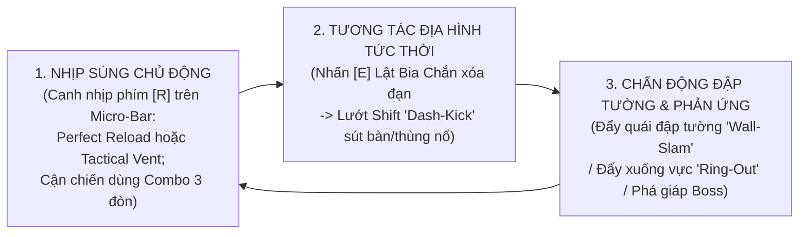
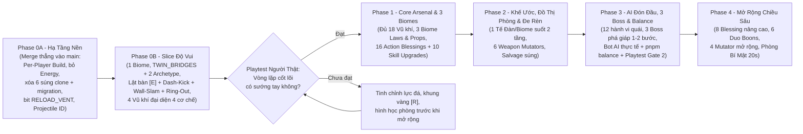

# ĐẶC TẢ THIẾT KẾ ĐẠI TU TOÀN DIỆN: ASHEN PACT 2.0 (MASTER OVERHAUL SPECIFICATION — REV 4)

> **Trạng thái:** **Draft v4 (Đã xử lý triệt để toàn bộ điểm phản biện Vòng 1 & Vòng 2 từ Opus) — Sẵn sàng lập kế hoạch Phase 0A / 0B**
> **Quy trình thiết kế:** [`docs/superpowers/workflows/adversarial-game-design-workflow.md`](../workflows/adversarial-game-design-workflow.md)
> **Hồ sơ nghiên cứu & phản biện (`docs/superpowers/specs/council/`):**
> - Giải phẫu Codebase hiện tại: [`01-codebase-autopsy.md`](./council/01-codebase-autopsy.md)
> - Phân tích Tinh hoa Thể loại (*Gungeon, Hades, Nuclear Throne*): [`02-genre-master-analysis.md`](./council/02-genre-master-analysis.md)
> - Bản nháp v1 & v2: [`03-draft-v1-overhaul.md`](./council/03-draft-v1-overhaul.md), [`06-draft-v2-overhaul.md`](./council/06-draft-v2-overhaul.md)
> - Biên bản Phản biện & Kiểm toán Toán học: [`04-round1-red-team-critique.md`](./council/04-round1-red-team-critique.md), [`05-round1-math-tech-audit.md`](./council/05-round1-math-tech-audit.md), [`07a-round2-red-team-verdict.md`](./council/07a-round2-red-team-verdict.md), [`07b-round2-math-tech-verdict.md`](./council/07b-round2-math-tech-verdict.md)

---

## MỤC LỤC
1. **Tầm Nhìn Cốt Lõi & Tam Giác Hành Động 3 Giây (`The 3-Second Tactical Loop`)**
2. **Phần 1 — Danh Sách Cắt Bỏ (`The Purge`) & Kế Hoạch Migration Codebase**
3. **Phần 2 — Hệ Thống Map Chiến Thuật, Biến Thiên Hình Học Phòng & Tương Tác Môi Trường (`Flip Cover [E]` & `Dash-Kick / Wall-Slam`)**
4. **Phần 3 — Hệ Thống Vũ Khí Chủ Động Tinh Gọn (`2 Nhịp [R] + Combo Cận Chiến 3 Đòn`) & 18 Vũ Khí Độc Bản**
5. **Phần 4 — Hệ Thống Nâng Cấp Theo Từng Người Chơi (`Per-Player Build`), Phước Lành Hành Động & Toán Học Chống Nổ Số**
6. **Phần 5 — Hệ Thống "Khế Ước Tro Tàn" (`1 Tế Đàn / Biome — Đánh Đổi Sinh Tử Suốt Biome`), Đồ Thị Phòng & Kinh Tế**
7. **Phần 6 — Đại Tu AI Quái (`Predictive Lead Aiming`) & Thiết Kế 3 Boss Phá Giáp Trực Quan (`1–2 Bước`)**
8. **Phần 7 — Kiến Trúc Đồng Bộ Mạng 60Hz (`Server-Authoritative Dynamic Projectiles`), Ngân Sách Thực Thể & Phạm Vi Client/Art/Audio**
9. **Phần 8 — Lộ Trình Triển Khai Có Cổng Kiểm Chứng Thực Tế (`Phase 0 Vertical Slice -> Phase 4`)**

---

## 0. TẦM NHÌN CỐT LÕI & TAM GIÁC HÀNH ĐỘNG 3 GIÂY (`THE 3-SECOND TACTICAL LOOP`)

**Ashen Pact 2.0** loại bỏ lối chơi *"giữ chuột trái đi lùi vòng tròn quanh căn phòng trống và nhìn thanh năng lượng tụt dần"* của *Soul Knight*, thay bằng **Tam Giác Hành Động Chủ Động** trực quan, dễ làm quen trong 3 giây đầu tiên cho nhóm bạn chơi Co-op LAN nhưng giàu chiều sâu kỹ năng:



### Nguyên Tắc Thiết Kế Cốt Lõi (Sau Phản Biện Kỹ Thuật)
1. **Đơn giản hóa thao tác điều khiển (Ergonomic Clarity):**
   - **Phím `[R]` (`RELOAD_VENT`):** Chỉ làm đúng **1 nhiệm vụ duy nhất** trong suốt trận đấu là **Canh Nhịp Nạp Đạn (`CLIP_RELOAD`) hoặc Xả Nhiệt (`HEAT_VENT`)** trên thanh Micro-Bar `32×5px`. Không dùng Chuột Trái để kích hoạt `Perfect Reload` (tránh bấm trượt khi đang giữ cò bắn). Không gán thao tác phân rã vũ khí vào phím `[R]`.
   - **Vũ khí Cận chiến (`MELEE_COMBO`):** Không dùng thanh `[R]`. Chỉ dùng **Chuỗi Combo 3 Đòn**; đòn chém tuyệt kỹ và khả năng **Đánh Bật Đạn (`Parry Deflect`)** được tích hợp trực tiếp vào **Đòn thứ 3** của chuỗi combo.
   - **Phím `[E]` (`INTERACT`):** Ưu tiên 1: Cứu đồng đội $\to$ Ưu tiên 2: Lật Bia Chắn (`'low' -> 'flipped'`) $\to$ Ưu tiên 3: Nhặt đồ / Tương tác đài.
   - **Phím `Shift` (`DASH`):** Lướt né đòn; khi lướt xuyên qua Bia Chắn đã lật (theo góc hướng tới `dot >= 0.45`) hoặc Đồ Chơi hình tròn sẽ kích hoạt **`Dash-Kick`** sút vật thể bay đi với vận tốc `520 px/s`.
   - **Phím `DROP_WEAPON`:** Bấm nhanh để đổi/vứt súng; **giữ `0.5s` ngoài giao tranh** khi đứng cạnh vũ khí dưới đất để **Phân Rã Vũ Khí (`Weapon Salvage`)** thành Vàng.
2. **Kiểm chứng thực tế trước khi mở rộng (`Vertical Slice First`):**
   - Triển khai **Phase 0 (Vertical Slice)** với 1 Biome, 3 Archetype phòng (có lật đối xứng & dịch chuyển vị trí prop), vòng lặp `Lật bàn [E] + Dash-Kick + Wall-Slam`, và 8 vũ khí đại diện để playtest cảm giác tay thực tế trước khi sản xuất hàng loạt nội dung.

---

## PHẦN 1: DANH SÁCH CẮT BỎ (`THE PURGE`) & KẾ HOẠCH MIGRATION CODEBASE

### 1.1. Bảng Cắt Bỏ & Thay Thế Hệ Thống Cũ
| STT | Hạng mục cắt bỏ | Vị trí trong Code hiện tại | Lý do cắt bỏ | Cơ chế thay thế trong Ashen Pact 2.0 |
|---:|---|---|---|---|
| 1 | **Thanh Năng Lượng (`energy`, `maxEnergy`, `energyCost`) & Cầu Năng Lượng** | [`sim-player.ts:163-183, 523-536`](file:///c:/Freelancer/game-coop-team/packages/shared/src/sim/sim-player.ts#L163-L183), [`weapons.ts`](file:///c:/Freelancer/game-coop-team/packages/shared/src/data/weapons.ts) | Dư thừa khi dọn phòng thường, nhưng cạn kiệt bất lực khi đánh Boss khiến người chơi bị khóa vũ khí chính. | **2 Nhịp Súng Chủ Động (`CLIP_RELOAD`, `HEAT_VENT`)** trên thanh Micro-Bar `32×5px` + phím `[R]`, và **Combo 3 Đòn (`MELEE_COMBO`)** cho cận chiến. |
| 2 | **Bố cục "Cái Hộp 36×22" với 4 cột đá 2×2 cố định ở 4 góc** | [`arena-map.ts:60-65, 150-218`](file:///c:/Freelancer/game-coop-team/packages/shared/src/sim/arena-map.ts#L60-L65) | `roomSeed % 3` chỉ dịch cột đi 1–3 ô gạch, để trống bãi đất giữa phòng khiến mọi trận đánh chỉ là đi lùi vòng tròn. | **Archetype Hình học Phòng Chiến Thuật** có phép biến đổi đối xứng (`FlipX / FlipY`) và dịch chuyển vị trí vật cản (`Prop Jitter`). |
| 3 | **Tọa độ Vật thể (Props) & Bề mặt (Surfaces) đặt cứng** | [`sim-dungeon-rooms.ts:276-294`](file:///c:/Freelancer/game-coop-team/packages/shared/src/sim/sim-dungeon-rooms.ts#L276-L294), [`arena-map.ts:168-186`](file:///c:/Freelancer/game-coop-team/packages/shared/src/sim/arena-map.ts#L168-L186) | Mọi phòng ở mọi tầng đều đặt thùng nổ ở `(15,6)`, nấm rừng mọc cả ở Hầm Băng. | **Hệ thống Bia Chắn Lật `[E]` & Đồ Chơi Chiến Thuật Theo Biome** có sát thương tăng tiến theo Tầng và `% MaxHP` của quái. |
| 4 | **Phòng Bí Mật cố định ở `(3,2)` phía Bắc phòng Khởi đầu + 2 thùng nổ đặt sẵn** | [`dungeon-gen.ts:198-212`](file:///c:/Freelancer/game-coop-team/packages/shared/src/sim/dungeon-gen.ts#L198-L212), [`sim-props-spawning.ts:25-26`](file:///c:/Freelancer/game-coop-team/packages/shared/src/sim/sim-props-spawning.ts#L25-L26) | Cho không rương Epic/Legendary ở giây thứ 2 của mọi lượt chơi, làm hỏng đường cong tiến triển. | **Phòng Bí Mật Động (`Dynamic Secret Room`)**: Gắn ngẫu nhiên vào cạnh trống của Phòng Kho Báu/Thương Nhân/Combat, mở bằng **`Dash-Kick` Thùng Nổ / `Wall-Slam`** vào tường nứt. |
| 5 | **Giải đố Bàn đạp + Cục đá tự hút nam châm ở Phòng Kho Báu** | [`sim-dungeon-rooms.ts:222-251`](file:///c:/Freelancer/game-coop-team/packages/shared/src/sim/sim-dungeon-rooms.ts#L222-L251), [`sim-enemies-core.ts:55-73`](file:///c:/Freelancer/game-coop-team/packages/shared/src/sim/sim-enemies-core.ts#L55-L73) | Cục đá đặt cách bàn đạp 60px và tự hút vào bàn đạp trong 1 giây, không có tính thử thách. | Thay bằng **Xưởng Rèn Kho Báu** (Rương Vũ Khí + **Đe Rèn Cổ Đại** để gắn `Weapon Mutator`). |
| 6 | **Mảng Buff toàn cục `this.activeBuffIds` dùng chung cho cả phòng** | [`world-sim.ts:83`](file:///c:/Freelancer/game-coop-team/packages/shared/src/sim/world-sim.ts#L83), [`sim-progression-bot.ts:77-132`](file:///c:/Freelancer/game-coop-team/packages/shared/src/sim/sim-progression-bot.ts#L77-L132) | Khiến cả 4 người chơi có bộ buff giống hệt nhau và làm cạn sạch bể 8 buff của Solo ngay ở Tầng 4. | Chuyển `blessingIds`, `weaponMutators`, `duoBoonIds`, `activePact` về từng **`SimPlayerState` độc lập**. |

### 1.2. Cắt Bỏ 6 Vũ Khí Clone (`24 -> 18 Vũ Khí Độc Bản`) & 6 Thẻ Cộng Chỉ Số Phẳng
1. **6 Vũ khí bị loại bỏ khỏi [`weapons.ts`](file:///c:/Freelancer/game-coop-team/packages/shared/src/data/weapons.ts):**
   - `rusty_pistol` (trùng lặp với `rivet_gun`)
   - `dual_pistols` (shotgun mini tầm thấp kém hiệu quả)
   - `venom_smg` (trùng lặp với `gale_smg`)
   - `frost_bow` (trùng lặp với `hunter_crossbow`)
   - `frost_scepter` (trùng lặp với `apprentice_staff`)
   - `dragon_breath_shotgun` (trùng lặp với `scrap_shotgun`)
2. **6 Thẻ cộng chỉ số phẳng (`Stat-Sticks`) bị loại bỏ khỏi `FLOOR_BUFFS` trong [`enemies.ts`](file:///c:/Freelancer/game-coop-team/packages/shared/src/data/enemies.ts):**
   - `vitality_surge`, `iron_bastion`, `arcane_wellspring`, `eagle_precision`, `gale_reflex`, `ricochet_mastery` (bản cũ).
   - Cập nhật 2 thẻ kỹ năng nhân vật: `vanguard_fortress` $\to$ `vanguard_bastion_prism`, `elementalist_dual` $\to$ `elementalist_twin_orbit`.

### 1.3. Kế Hoạch Migration Codebase Khi Xóa 6 Vũ Khí & Thanh Energy
Để đảm bảo không gãy bất kỳ module hay bài test nào khi loại bỏ 6 vũ khí và thanh `energy`:
1. **Khởi tạo Vũ khí Nhân vật ([`sim-coop-hub.ts:19`](file:///c:/Freelancer/game-coop-team/packages/shared/src/sim/sim-coop-hub.ts#L19) và [`sim-coop-hub.ts:355`](file:///c:/Freelancer/game-coop-team/packages/shared/src/sim/sim-coop-hub.ts#L355)):**
   - Hiện tại ở cả `createPlayerStateImpl` (dòng 19) và `applyCharacterStatsToPlayer` (dòng 355): `const starterWeapons = [cDef.starterWeaponId, 'rusty_pistol'].slice(0, MAX_WEAPON_SLOTS);`
   - Thay đổi tại cả 2 vị trí: `const starterWeapons = [cDef.starterWeaponId];` — Mọi nhân vật bắt đầu chuyến đi với **1 vũ khí khởi đầu đặc trưng của Class ở Ô 1**, để trống Ô 2 (giúp vũ khí đầu tiên nhặt được trong hầm ngục tự động lấp vào Ô 2 mà không làm rơi mất vũ khí khởi đầu; riêng với `vanguard` cầm `knight_sword`, Đòn thứ 3 của combo phóng Kiếm Khí tầm xa `240px` nên vẫn bắn phá được trụ/vật thể bên kia vực).
2. **Dọn dẹp Tham chiếu Client & Art Rig:**
   - Giữ lại toàn bộ 18 rig vũ khí còn dùng trong [`rig-defs-weapons-1.ts`](file:///c:/Freelancer/game-coop-team/apps/client/src/art/rig-defs-weapons-1.ts) và [`rig-defs-weapons-2.ts`](file:///c:/Freelancer/game-coop-team/apps/client/src/art/rig-defs-weapons-2.ts); gỡ bỏ 6 entry của vũ khí bị xóa khỏi [`rig-defs.ts`](file:///c:/Freelancer/game-coop-team/apps/client/src/art/rig-defs.ts), [`art-gallery-pages.ts`](file:///c:/Freelancer/game-coop-team/apps/client/src/scenes/art-gallery-pages.ts), [`entity-sync.ts`](file:///c:/Freelancer/game-coop-team/apps/client/src/scenes/game-scene/entity-sync.ts).
   - Thay thế thanh Energy màu xanh trên HUD ([`hud-combat-and-coop.ts`](file:///c:/Freelancer/game-coop-team/apps/client/src/scenes/game-scene/hud-combat-and-coop.ts)) bằng hiển thị trạng thái Băng Đạn / Nhiệt Độ của vũ khí đang cầm, kết hợp thanh **Micro-Bar `32×5px`** dưới chân nhân vật khi nạp đạn / tích nhiệt.
3. **Cập nhật Test Suite:**
   - Cập nhật các bài unit test trong `packages/shared/test/*.test.ts` (như `polish-p2-weapons.test.ts`, `balance-overhaul-b1.test.ts`, v.v.) đang truyền `'rusty_pistol'`, `'venom_smg'`, `'frost_bow'` sang các ID vũ khí tương ứng trong bộ 18 vũ khí (`'rivet_gun'`, `'gale_smg'`, `'hunter_crossbow'`).

---

## PHẦN 2: HỆ THỐNG MAP CHIẾN THUẬT, BIẾN THIÊN HÌNH HỌC & TƯƠNG TÁC MÔI TRƯỜNG

### 2.1. Sáu (06) Archetype Hình Học Phòng & Biến Thiên Chống Học Thuộc Lòng (`Mirror & Prop Jitter`)

Trên khung lưới `36×22` ô gạch (`1152×704px`), `ArenaMap.configureRoomLayout(roomSeed, archetype, biome, activeDoorSides)` định hình không gian chiến đấu:
- **Phase 0B–1 triển khai trước 3 Archetype cốt lõi (`TWIN_BRIDGES`, `GAUNTLET_CHOKEPOINT`, `CENTRAL_BASTION`)**; **Phase 2 mở rộng thêm 3 Archetype (`CROSSFIRE_CONVEYORS`, `PRISM_LABYRINTH`, `CRUMBLING_PILLAR_RING`)**.
- **Chống lặp bố cục (Procedural Variation Rules):**
  1. **Lật Đối Xứng & Xoay Hướng Theo Cửa (`Mirror & Door-Aware Transform`):** Dựa trên `roomSeed`, bố cục phòng tự động áp dụng `flipX = (roomSeed & 1) !== 0` và `flipY = (roomSeed & 2) !== 0`.
  2. **Dịch Chuyển Vị Trí Vật Thể (`Prop Jitter ±1..2 Tiles`):** Các điểm đặt Bia Chắn và Đồ Chơi Biome không cố định cứng một tọa độ `(tx, ty)`, mà được chọn từ danh sách vùng neo hợp lệ (`Anchor Zones`) và dịch ngẫu nhiên `±1..2` ô gạch theo `roomSeed`.
  3. **Bảo Toàn Hành Lang Cửa (`Door Clearance Guarantee`):** Tại 4 tọa độ cửa chuẩn (`N: (18,1)`, `S: (18,20)`, `W: (1,11)`, `E: (34,11)` trong [`sim-dungeon-rooms.ts:27-39`](file:///c:/Freelancer/game-coop-team/packages/shared/src/sim/sim-dungeon-rooms.ts#L27-L39)), vùng sảnh cửa `3×3` quanh các cửa đang mở (`activeDoorSides`) luôn là sàn phẳng (`floor`) nối thông trực tiếp vào các cây cầu/hành lang chính.

| Mã Archetype | Tên Hình Học Phòng | Cấu trúc Lưới Ô Gạch (`36×22`) & Vách Ngăn (Đã chuẩn hóa với 4 Cửa) | Chiến thuật & Thay đổi Cách Di Chuyển |
|---|---|---|---|
| `TWIN_BRIDGES` *(Phase 0B)* | **1. Đấu Trường Cầu Đôi Bắc Qua Vực** | - **Thống nhất dùng `SurfaceKind = 'chasm'` ở cả 3 Biome** (hiển thị theo chủ đề Biome: *Vực Rễ Sâu* ở Biome 1, *Vực Băng Thẳm* ở Biome 2, *Vực Lò Nung* ở Biome 3) để cơ chế **`Ring-Out` hoạt động đồng nhất ở mọi tầng ngay từ Biome 1**.<br>- **Cắt đôi phòng thật sự (`True Chokepoint`):** Dải vực `chasm` kéo dài **sát tường từ `ty: 1..20`** (`tx: 15..20`), chỉ chừa đúng **2 cây cầu rộng 3 ô (`ty: 5..7` và `ty: 14..16`)**. Nếu phòng có cửa Bắc (`(18,1)`) hoặc Nam (`(18,20)`), dải vực tự động rẽ nhánh chữ Y ôm quanh sảnh cửa (`tx: 13..15` và `tx: 20..22` nối thẳng sát tường Bắc/Nam), **chặn đứng việc đi vòng dọc mép tường trên/dưới và buộc 100% quái vật lẫn người chơi phải đi qua 2 cây cầu**! | Chấm dứt việc chạy vòng tròn quanh tâm phòng. Quái bộ binh buộc phải dồn qua 2 cây cầu hẹp — vị trí lý tưởng cho **`Dash-Kick` Khối Băng/Thùng Nổ** hoặc đẩy quái rơi xuống vực (**`INSTANT RING-OUT!`**). |
| `GAUNTLET_CHOKEPOINT` *(Phase 0B)* | **2. Hành Lang Chữ Thập & Góc Khuất Chữ L** | Bốn khối tường chữ L (`4×3` ô) nhô ra từ 4 góc vào trung tâm (`tx: 8..11, 24..27`), kết hợp 2 bức tường chắn ngắn tạo thành hành lang chữ thập với 4 góc khuất. | Khoảng cách giữa các bức tường song song chỉ `160–220px`, tối ưu cho **Vũ khí Nảy Tường (`Ricochet`)**, **Chấn Động Đập Tường (`Wall-Slam`)** và lật bàn khóa hành lang. |
| `CENTRAL_BASTION` *(Phase 0B)* | **3. Đấu Trường Lõi Pháo Đài** | Trung tâm phòng (`tx: 15..20, ty: 8..13`) là cụm công sự hình hộp có 2 lối vào, bao quanh bởi **4 Bia Chắn Lật Được** và **Đồ Chơi Chủ Đạo của Biome**. Quái xuất hiện từ 4 góc ép vào. | Người chơi chọn: **Chiếm giữ Lõi Pháo Đài**, lật các tấm bia để tử thủ và bắn tỏa ra ngoài, hoặc đánh vòng ngoài và dùng Lõi Pháo Đài che đường đạn của đội hình địch. |
| `CROSSFIRE_CONVEYORS` *(Phase 2)* | **4. Dây Chuyền Giao Lộ Tốc Độ Cao** | Hai làn **Băng Chuyền / Luồng Gió / Dòng Chảy** rộng 3 ô chạy song song (`ty: 6..8` chảy sang Đông, `ty: 13..15` chảy sang Tây), ngăn cách bởi các trụ chắn nhỏ. | Mặt sàn cuốn người chơi, quái vật và các Vật Chắn đang trượt đi với vận tốc `110 px/s`. Người chơi có thể `Dash-Kick` một thùng nổ/nồi dung nham lên băng chuyền để nó tự trôi vào giữa đám xạ thủ địch. |
| `PRISM_LABYRINTH` *(Phase 2)* | **5. Mê Cung Khúc Xạ So Le** | 5 bức tường chắn so le (`2×4` ô) bố trí dạng bàn cờ khắp phòng, xen kẽ là các **Trụ Lăng Kính / Trụ Đá Mục / Búa Máy**. | Cắt tầm nhìn thẳng (Line-of-Sight). Khuyến khích tận dụng góc bắn khúc xạ, đạn cầu vồng vượt tường, hoặc `Dash-Kick` vật chắn dội qua góc khuất. |
| `CRUMBLING_PILLAR_RING` *(Phase 2)* | **6. Vòng Tròn Sáu Cột Sập** | 6 cây cột lớn (`2×2` ô) xếp thành hình lục giác quanh tâm phòng, kèm 4 Bia Chắn nằm giữa các khe cột. | Đầu trận che chắn dày đặc; mỗi khi cột đá bị bắn gãy hoặc quái bị `Wall-Slam` đập vào, cột sập xuống đè bẹp một vùng dài `160px` và mở thông dần không gian phòng. |

---

### 2.2. Hai (02) Quy Luật Vật Lý Chiến Thuật Toàn Cục (`Flip Cover [E]` & `Dash-Kick / Wall-Slam`)

#### Quy luật Toàn cục 1: Lật Chắn Bằng `[E]` & Đá Trượt Bằng `Dash-Kick / Melee`
1. **Thứ tự Ưu tiên Cứng của Phím `[E]` (`INTERACT`) trong bán kính `52px`:**
   - **Ưu tiên 1:** Cứu đồng đội đang gục (`Revive`).
   - **Ưu tiên 2:** **Lật Bia Chắn từ Nằm sang Dựng (`coverState: 'low' -> 'flipped'`)**.
     - Khi ở trạng thái `'low'`, đạn bay qua bình thường và người chơi có thể đi/lướt qua.
     - Ngay khoảnh khắc nhấn `[E]` lật bàn sang `'flipped'` (`hp = 60`, chặn đạn & chặn di chuyển), phát ra một vòng **`Micro-Blank` bán kính `56px` trong `0.15s` xóa đạn địch đang bay tới** và đẩy lùi nhẹ quái sát bên.
     - **Không tự hủy chỗ nấp:** Khi bàn đã ở trạng thái `'flipped'`, nhấn `[E]` thêm lần nữa **không làm gì cả** (tấm bàn đứng vững che đạn cho người chơi).
   - **Ưu tiên 3:** Nhặt vật phẩm / Mở rương / Tương tác đài (chỉ kích hoạt khi không có đồng đội gục và không có bàn `'low'` trong `52px`).
2. **Thao tác Đá Trượt (`Dash-Kick` & `Melee-Kick`):**
   - Để sút văng một tấm Bia Chắn đã dựng (`'flipped'`) hoặc một Đồ Chơi Đẩy Trượt (`explosive_barrel`, `volatile_spore_pod`, `sliding_ice_block`, `slag_crucible`), người chơi thực hiện **1 trong 2 hành động chủ động**:
     - **Cách A — `Dash-Kick` (Lướt Tông bằng phím `Shift`):**
       - Với **Bia Chắn Đã Lật (`'flipped'`)**: Chỉ kích hoạt `Dash-Kick` khi vector hướng lướt của người chơi hướng về phía tấm chắn với **`dot(dashDir, dirFromPlayerToProp) >= 0.45`** (góc `±63°`), đảm bảo lướt ngang song song sau bàn chắn không làm bay mất chỗ nấp.
       - Với **Đồ Chơi Đẩy Trượt Hình Tròn**: Chạm ở bất kỳ góc nào trong lúc `Dash` đều sút văng ngay.
       - Khi kích hoạt `Dash-Kick` trong `resolvePropMovementCollision(p)`, chuyển ngay `prop.coverState = 'sliding'`, `prop.blocksMovement = false` và **bỏ qua việc đẩy lùi tọa độ `(p.x, p.y)` của người chơi ở tick đó** (lướt mượt không khựng frame), đồng thời sút vật thể bay đi với vận tốc **`520 px/s` theo hướng `aimAngle`**.
     - **Cách B — `Melee-Kick` (Chém Cận Chiến hoặc Xung Phong Khiên):** Vung vũ khí cận chiến hoặc dùng kỹ năng Xung Phong đập vào vật thể cũng sút văng vật thể đó theo hướng `aimAngle` với vận tốc `520 px/s`.
   - Trên đường trượt, vật thể nghiền qua kẻ địch, gây **Sát thương Đá Trượt (`Dmg_KickSlide`)**, làm **Choáng (`Stun`) `1.0s`**, đẩy lùi quái (`knockback = 260`), và vỡ/nổ khi đâm vào tường cuối phòng.

#### Quy luật Toàn cục 2: Chấn Động Đập Tường (`Wall-Slam`), Công Thức Scaling Môi Trường & Thanh Chấn Động Boss (`bossStaggerAccum`)
1. **Công thức Scaling Sát Thương Môi Trường (Đã điều chỉnh chống lạm phát sát thương prop):**
   Gọi hệ số tăng tiến theo tầng toàn cục (`globalFloor` $F \in \{1..6\}$) là:
   $$M_{\text{floor}}(F) = 1 + 0.22 \times (F - 1) \quad (\text{Tầng 1: } 1.00\times \longrightarrow \text{Tầng 6: } 2.10\times)$$
   - **Sát thương Đá Trượt Vật Chắn (`Kick-Slide`):**
     $$\text{Dmg}_{\text{KickSlide}}(e) = \text{round}\Big(20 \times M_{\text{floor}}(F) + \alpha_{\text{kick}}(e) \times e.\text{maxHp}\Big), \quad \alpha_{\text{kick}} = \begin{cases} 0.10 & \text{(Quái thường)} \\ 0.05 & \text{(Tinh Anh)} \\ 0.015 & \text{(Boss)} \end{cases}$$
   - **Sát thương Chấn Động Đập Tường (`Wall-Slam` — khi quái có `hypot(kbVx, kbVy) >= 120 px/s` va chạm tường/cột/bia chắn):**
     $$\text{Dmg}_{\text{WallSlam}}(e) = \text{round}\Big(14 \times M_{\text{floor}}(F) + 0.30 \times \text{lastHitDmg} + \alpha_{\text{slam}}(e) \times e.\text{maxHp}\Big), \quad \alpha_{\text{slam}} = \begin{cases} 0.08 & \text{(Quái thường)} \\ 0.04 & \text{(Tinh Anh)} \\ 0.01 & \text{(Boss)} \end{cases}$$
     - Làm khựng quái (**Hit-stun `0.40s`**, ngắt đòn Telegraph của quái thường/Tinh Anh) kèm chữ `ĐẬP TƯỜNG!`.
     - Nếu kẻ địch đang **Đóng Băng (`e.frozenTimer > 0`)**, va chạm `Wall-Slam` kích nổ phản ứng **VỠ BĂNG (`Shatter`)** ngay lập tức.
   - **Sát thương Đồ Chơi Hạng Nặng Của Biome (`Trụ Đá Mục`, `Cọc Nhũ Băng`, `Búa Máy`, `Thảm Dung Nham`):**
     $$\text{Dmg}_{\text{Hazard}}(e) = \begin{cases} \text{round}\big(\text{baseHazardDmg} \times M_{\text{floor}}(F) + 0.20 \times e.\text{maxHp}\big) & \text{nếu } !e.\text{isBoss} \\ \text{round}\big(0.06 \times e.\text{maxHp}\big) & \text{nếu } e.\text{isBoss} \text{ (Đòn Phá Giáp Boss = 6% MaxHP)} \end{cases}$$
2. **Đẩy Quái Xuống Vực (`Chasm Ring-Out` — Hoạt động ở cả 3 Biome):**
   - Mọi ô vực sâu trong cả 3 Biome đều sử dụng `SurfaceKind = 'chasm'` (render theo chủ đề Biome: *Vực Rễ Cây* ở Biome 1, *Vực Băng* ở Biome 2, *Vực Lò Nung* ở Biome 3).
   - Kẻ địch bộ binh (`!e.flying && !e.isBoss`) bị đẩy rơi vào ô `chasm`: **Quái thường bị tiêu diệt tức thì (`RING-OUT!`)** và bắn vọt vàng/loot ngược lên mép bờ gần nhất; **Quái Tinh Anh mất 30% MaxHP** và nảy ngược lên bờ kèm Choáng `1.0s`.
3. **Cơ chế Tiếp Tế Phòng Boss (`Boss Supply Drop`) & Thanh Chấn Động (`bossStaggerAccum`):**
   - **Tiếp Tế Phòng Boss (`Boss Supply Drop`):** Trong phòng `boss`, cứ mỗi **`18.0 giây`** (và khi Boss chuyển Phase ở `66% HP` & `33% HP`), nếu số lượng `Flippable Barricade` và `Biome Prop` trong phòng `< 3`, đấu trường thả bổ sung (có vòng chỉ thị `0.6s`) để duy trì đủ **3 Bia Chắn + 2 Đồ Chơi Biome**.
   - **Thanh Chấn Động Boss (`bossStaggerAccum: 0..100`):** Mỗi khi Boss nhận đòn có `knockback > 0`, tích lũy $\Delta\text{Stagger} = (\text{knockback} / 12) \times \text{procCoefficient}$ (bị `Dash-Kick` Bia Chắn / Đồ Chơi đập trúng cộng thẳng `+50 Stagger`). Khi `bossStaggerAccum >= 100`: Reset về `0` (Cooldown tích lại `6.0s`), kích nổ hiệu ứng `WALL-SLAM` ngay trên người Boss (làm Boss khựng `0.5s` và kích hoạt mọi Phước lành liên quan đến `Wall-Slam` / `Barricade Techs`).

---

### 2.3. Quy Luật Sinh Tồn (`Biome Law`) & Đồ Chơi Tương Tác Theo Từng Biome

Mỗi Biome có **1 Bia Chắn Lật Được Bằng `[E]`** và **2 Đồ Chơi Tương Tác Đặc Trưng**:

| Biome | Quy Luật Sinh Tồn Đặc Trưng (`Biome Law`) | 1 Bia Chắn Lật `[E]` + 2 Đồ Chơi Đặc Trưng |
|---|---|---|
| **BIOME 1: RỪNG CỔ MỤC NÁT**<br>*(Phản ứng Sinh Học, Sút Bóng Bào Tử & Đập Cột Đè Quái)* | **Luật "Thảm Thực Vật Cộng Hưởng":**<br>- Đứng trong **Cỏ Rậm (`tall_grass`)** và thực hiện **`Dash`** hoặc **`Perfect Reload [R]`** phóng phấn hoa tăng **+25% Tốc chạy trong 2s**.<br>- Nguyên tố **Lửa** chạm vào Cỏ Rậm hoặc Đầm Độc sẽ **cháy lan dây chuyền (`320 px/s`)**, thiêu đốt quái đứng trên đó. | **1. Bàn Đá Rêu Cổ (`moss_table` — *Bia Chắn Lật `[E]`*):** Lật bằng `[E]` tạo bia chắn đá `60 HP`. Khi bị bắn vỡ hoặc `Dash-Kick` đâm vỡ, bung vùng **Phấn Hoa Hồi Giáp (`+1 Giáp`, `r=72px`)**.<br>**2. Túi Bào Tử Căng Phồng (`volatile_spore_pod`):** Dùng **`Dash-Kick` hoặc đòn Cận chiến** sút văng quả nang bay đi (`520 px/s`), chạm quái/tường nổ vùng **Độc + Trói chân `1.2s`** (`r=96px`).<br>**3. Trụ Đá Mục (`rotten_totem_pillar`):** Khi bị bắn gãy hoặc có quái bị `Wall-Slam` / `Dash-Kick` đập vào, cột **đổ sập theo hướng lực tác động**, đè dải chữ nhật **`160×56px`** gây `Dmg_Hazard` + Choáng `1.5s`. |
| **BIOME 2: HẦM BĂNG VĨNH CỬU**<br>*(Bi-a Băng Giá, Khúc Xạ Tia Đạn & Cọc Nhũ Băng)* | **Luật "Quán Tính Băng Vĩnh Cửu":**<br>- Trên mặt băng (`ice`), lực đẩy lùi (`Knockback`) lên quái vật và khoảng cách trượt của các vật thể (`Dash-Kick`) **tăng +50%**.<br>- Mọi đòn `Wall-Slam` trong Biome 2 tự động áp **1 cộng dồn Lạnh (`Chill`)** lên kẻ địch (`r=64px`). | **1. Phiến Băng Cổ Đại (`glacial_barricade` — *Bia Chắn Lật `[E]`*):** Lật bằng `[E]` tạo bia chắn băng (`65 HP`). Khi **`Dash-Kick` sút trượt đi** và đâm trúng quái/tường, phiến băng vỡ tung và **đóng cọc 3 Nhũ Băng Nhọn xuống sàn (`Dmg_Hazard` + Đóng Băng `1.5s`, tồn tại `4s` làm cột chắn đạn)**.<br>**2. Khối Băng Trượt (`sliding_ice_block`):** Dùng **`Dash-Kick` hoặc Cận chiến** sút khối băng trượt xuyên phòng (`600 px/s`), **nảy qua tường 1 lần như bi-a**, húc văng cả hàng quái.<br>**3. Lăng Kính Pha Lê (`cryo_prism_pillar`):** Khi bắn đạn vào Lăng Kính, viên đạn **khúc xạ tách làm 3 tia hình quạt (`+20% Additive DMG`, tẩm `Lạnh`, tuân thủ `splitGeneration`)** hướng về phía cụm quái đông nhất. |
| **BIOME 3: LÒ RÈN DUNG NHAM**<br>*(Chu Kỳ Nhà Máy, Đổ Nồi Nung Xỉ & Búa Máy Dập Quái)* | **Luật "Nhịp Đập Lò Nung":**<br>- Các dải **Băng Chuyền Thép (`conveyor`)** tự động đảo chiều đồng bộ theo **Chu Kỳ Nhà Máy mỗi `8.0s`** (có đèn mũi tên nhấp nháy cảnh báo **`1.2s`** trước khi đổi chiều).<br>- Vũ khí `HEAT_VENT` tăng nhiệt nhanh hơn +15%, nhưng **Xung Xả Áp `[R]` rộng gấp rưỡi (`r=110px`)**. | **1. Tấm Chắn Thép Phản Nhiệt (`forge_blast_shield` — *Bia Chắn Lật `[E]`*):** Lật bằng `[E]` tạo khiên thép `85 HP`. Khi **`Dash-Kick` sút tấm chắn đi**, nó lao dọc sàn và phóng kèm **Cơn Sóng Lửa rộng `88px`**.<br>**2. Búa Máy Dập Khuôn Cảm Biến (`pneumatic_press`):** Đặt giữa phòng/băng chuyền (Cooldown `4.0s`). Khi người chơi **`Dash-Kick` một vật chắn / quái vật trượt vào khung búa** (hoặc khi quái/Boss bước vào tâm cảm biến), Búa Máy dập xuống sau `0.35s` gây `Dmg_Hazard` nghiền quái & phá giáp Boss (chỉ đẩy nhẹ người chơi ra mép, `0` sát thương lên người chơi).<br>**3. Nồi Nung Xỉ Nóng Chảy (`slag_crucible`):** Khi **`Dash-Kick` hoặc bắn vỡ**, nồi nung đổ tràn **Thảm Dung Nham dài `192px`** thiêu đốt hàng quái. |

---

## PHẦN 3: HỆ THỐNG VŨ KHÍ CHỦ ĐỘNG TINH GỌN (`2 NHỊP [R] + COMBO CẬN CHIẾN`) & 18 VŨ KHÍ ĐỘC BẢN

### 3.1. Xóa Bỏ Thanh Energy & Tái Định Nghĩa Nội Tại Nhân Vật
1. **Nội tại Thiết Vệ (`vanguard` — Ý Chí Thép):** Giáp tự hồi nhanh hơn (delay `3.0s`); mỗi viên đạn địch chặn bằng `Tường Khiên Hồng Ngọc` **nạp lại 1 viên đạn vào băng (hoặc giảm 15% Nhiệt) VÀ cộng `+15% Additive Damage` cho phát bắn / nhát chém kế tiếp (tối đa `+75%`)**.
2. **Kỹ năng Liệp Ưng (`ranger` — Mũi Tên Săn Mồi):** Hạ gục mục tiêu bị Đánh Dấu rơi ra **Huy Hiệu Săn Mồi (`Prey Emblem`)**: nhặt vào lập tức **Nạp Đầy Băng Đạn Cường Hóa (`Overclocked Shot`) + giảm `2.0s` hồi chiêu Kỹ năng**.
3. **Đồng Đội Combo (`Team Elemental Reaction`):** Khi người chơi A áp nguyên tố mồi và người chơi B kích nổ Phản Ứng Nguyên Tố trong vòng `3.0s`, cả hai nhận **Hội Tụ Nguyên Tố (`Elemental Convergence` trong `3.0s`)**: làm mới đầy Băng đạn / đưa Nhiệt về `0%` + tăng `+20%` Tốc độ di chuyển & `+20%` Tốc độ bắn.

---

### 3.2. Hai (02) Nhịp Súng Dùng Phím `[R]` & Một (01) Nhịp Cận Chiến Combo 3 Đòn

Để thao tác điều khiển gọn gàng, trực quan và không gây quá tải nhận thức:
- **Chỉ có vũ khí tầm xa (`CLIP_RELOAD` và `HEAT_VENT`) mới hiển thị thanh Micro-Bar `32×5px` và sử dụng phím `[R]`.**
- **Tuyệt đối không dùng Chuột Trái để kích hoạt `Perfect Reload`** (người chơi giữ chuột trái bắn liên tục khi hết đạn sẽ tự động bắt đầu nạp đạn, và bấm **`[R]`** để canh nhịp `Perfect Reload`).
- **Đã loại bỏ `Blade Gauge` và `Quickswap Burst`** để giảm số trạng thái phải theo dõi. Vũ khí cất trong túi tự động nạp đầy sau `2.0s` (`Holster Auto-Reload`).

1. **Nhịp 1 — `CLIP_RELOAD` (Băng Đạn Ngắn + Canh Nhịp `Perfect Reload [R]` — 10 Vũ khí):**
   - Vũ khí có băng đạn ngắn (`clipSize: 2..8 viên`) và thời gian nạp (`reloadDurationSec: 0.85..1.30s`).
   - **Viên Cuối Băng (`Finale Shot`):** Viên đạn cuối cùng của băng gây **`+50% Additive Damage`**, **100% áp trạng thái Nguyên tố** và tự động kích hoạt hiệu ứng đặc trưng của súng (nổ đinh tán, rút mũi tên, nở hoa, v.v.).
   - **Nạp Nhịp Hoàn Hảo (`Perfect Reload` — Chỉ bằng phím `[R]`):** Khi đang nạp đạn, thanh Micro-Bar chạy từ `0% -> 100%`. Nếu người chơi nhấn **`[R]`** khi vạch chạy nằm trong **Khung Vàng (`45% – 70%`)**:
     - Súng **hoàn tất nạp đạn ngay tại thời điểm bấm `[R]`** (tiết kiệm được `30%–55%` thời gian nạp còn lại) kèm tia sáng vàng + âm thanh *"Ching!"*.
     - Phát đạn đầu tiên của băng mới trở thành **Đạn Quá Tải (`Overclocked Shot: +45% Additive DMG`)** và kích hoạt hiệu ứng thưởng của súng.
     - *(Nếu bấm `[R]` trượt ngoài khung vàng: súng khóa nút `[R]` trong chu kỳ nạp đó và nạp hết phần thời gian còn lại như bình thường).*
2. **Nhịp 2 — `HEAT_VENT` (Tích Nhiệt Vùng Cam + Xả Áp Chiến Thuật `[R]` — 4 Vũ khí):**
   - Giữ cò bắn làm tăng thanh **Nhiệt Độ (`0% -> 100%`)** trên Micro-Bar.
   - **Vùng Nhiệt Cam (`65% – 95%`):** Tốc độ bắn tăng **`+25%`** và nhận **`+25% Additive Damage`**. Nếu bắn lố chạm `100%`: Quá Nhiệt, khóa cò `1.10s`.
   - **Xả Áp Chiến Thuật (`Tactical Vent` — Nhấn `[R]` khi Nhiệt ở `65% – 95%`):** Trong `0.25s`, nhân vật xả toàn bộ Nhiệt về `0%` và kích hoạt **Đòn Xả Áp Đặc Trưng của súng** (Xóa đạn địch sát thân + Phóng xung nhiệt / Tia Railgun / Siêu Tân Tinh).
3. **Nhịp 3 — `MELEE_COMBO` (Chuỗi Chém 3 Đòn, Đòn 3 Tuyệt Kỹ & `Parry Deflect` — 4 Vũ khí Cận Chiến):**
   - Không cần bấm `[R]` hay canh thanh phụ. Giữ hoặc nhấp Chuột Trái thực hiện chuỗi **3 Đòn Chém Liên Hoàn (`Đòn 1 -> Đòn 2 Lunge -> Đòn 3 Tuyệt Kỹ Chấn Động`)**, có nhịp nghỉ `comboRecoverySec = 0.25s` sau Đòn 3.
   - **Đòn Thứ 3 Là Đòn Tuyệt Kỹ & `Parry Deflect`:**
     - Ở **Đòn thứ 3** (vung vũ khí lóe sáng trắng trong `0.18s`), ngoài việc tung đòn đặc trưng của vũ khí (phóng Kiếm Khí bán nguyệt, ném Boomerang, bổ Đoạn Đầu Đài, giáng Cột Sét), lưỡi vũ khí kích hoạt **`Parry Deflect`**: đánh bật tối đa **3 viên đạn địch** chạm vào trong cửa sổ `0.18s` đó bay ngược về hướng `aimAngle` với tốc độ `760 px/s` thành đạn nổ của người chơi!
     - *(Đòn 1 và Đòn 2 chỉ gây sát thương cận chiến, không xóa và không phản đạn địch — đảm bảo vũ khí cận chiến vẫn phải di chuyển né đạn hoặc canh nhịp Đòn 3 để phản đạn).*

---

### 3.3. Bảng Mục Tiêu Thông Số & Cơ Chế Độc Bản Của 18 Vũ Khí

> **Lưu ý:** Các chỉ số `Target DPS (Thường / Active [R])` dưới đây là **mục tiêu thiết kế ban đầu** để giữ độ lệch giữa 5 vũ khí khởi đầu `< 5%`, và sẽ được kiểm chứng, tinh chỉnh tự động bằng công cụ `pnpm balance` sau khi hoàn thành prototype Phase 0.

#### A. Năm (05) Vũ Khí Khởi Đầu Đặc Trưng (`Signature Starter Weapons` — `Common`)

| # | ID & Nhân vật | Tên Vũ khí | Nhịp, Thông số & `procCoeff` | Target DPS (`Thường / Active`) | Cơ chế Độc Bản |
|---:|---|---|---|---:|---|
| 1 | `knight_sword`<br>*(Thiết Vệ)* | **Kiếm Hiệp Sĩ Đoạn Đạn** | **`MELEE_COMBO`**<br>- DMG 3 đòn: `12 -> 14 -> 24`<br>- Tốc chém: `2.1/s` (`recovery: 0.25s`)<br>- Tầm: `56px` · KB: `150/180/260`<br>- `procCoeff = 0.80` | `~31` / `~41` | - **Đòn 1 & 2:** Chém ngang/chéo kèm bước nhào `Lunge 24px`.<br>- **Đòn 3 (Tuyệt Kỹ + `Parry Deflect` `0.18s`):** Đập kiếm phóng **Lưỡi Kiếm Khí Bán Nguyệt tầm xa `240px` (`24 DMG`, xuyên quái)** đồng thời **Parry Deflect** đánh bật tối đa 3 viên đạn địch bay ngược về `aimAngle`! |
| 2 | `hunter_crossbow`<br>*(Liệp Ưng)* | **Nỏ Săn Hàn Thiết** | **`CLIP_RELOAD`**<br>- Băng: `4 mũi` · Nạp: `0.95s`<br>- DMG: `15` (Giữ cò `0.35s`: `22 DMG` xuyên 2)<br>- `procCoeff = 1.00` | `~30` / `~41` | - Bấm nhanh bắn tên `15 DMG`; giữ cò `0.35s` bắn **Mũi Tên Xuyên Phá (`22 DMG`, xuyên 2 quái, `kb=220`)**.<br>- Mỗi mũi tên trúng đích cắm lại trên thân quái (tối đa **4 mũi**).<br>- **Khi bắn `Finale Shot` (Mũi thứ 4) HOẶC bấm trúng `Perfect Reload [R]`:** Giật dây **rút toàn bộ mũi tên đang cắm**, gây **`6 DMG × số mũi tên`** và làm chậm 30%! |
| 3 | `apprentice_staff`<br>*(Lam Hỏa)* | **Trượng Tập Sự Tam Nguyên** | **`HEAT_VENT`**<br>- DMG: `11` (Nhiệt Cam: `13.8`)<br>- Tốc bắn: `2.6/s` (`heatPerShot: 14%`)<br>- Nguyên tố: Xoay vòng `Lửa/Băng/Sét`<br>- `procCoeff = 0.75` | `~30` / `~40` | - Phát bắn thứ 3 liên tiếp phóng **Quả Cầu Lớn (`17 DMG`, nổ `r=56px`)**.<br>- **Nhấn `[R]` Xả Áp (`Tactical Vent` ở `65%–95%` Nhiệt):** Xả nhiệt về `0%`, phát **xung nhỏ `r=56px` xóa đạn địch sát thân** và **phóng 1 Tia Tam Giác Nguyên Tố tới vị trí con trỏ chuột (`22 DMG`, nổ `r=72px`, 100% áp nguyên tố hiện hành)**! |
| 4 | `thorn_staff`<br>*(Mộc Linh)* | **Trượng Dây Gai Cộng Sinh** | **`CLIP_RELOAD`**<br>- Băng: `5 nhịp` · Nạp: `1.00s`<br>- DMG: `11` (`Finale: 17`, `Độc`)<br>- Tốc quất: `2.8/s` · Tầm: `240px`<br>- `procCoeff = 0.75` | `~29` / `~40` | - Mỗi phát bắn vươn dây gai dài `240px` quất xuyên hàng quái, áp `Độc` và cắm **1 Gai Ký Sinh** (tối đa **5 gai / mục tiêu**).<br>- **Nhịp thứ 5 (`Finale Shot`):** Dây gai quấn kẻ địch cuối tầm và **kéo giật nó văng ngược về trước mặt `90px`**.<br>- **Khi bấm trúng `Perfect Reload [R]` (hoặc sau `Finale Shot`):** Toàn bộ Gai Ký Sinh nở bung gây **`7 DMG Độc × số gai`**! |
| 5 | `rivet_gun`<br>*(Bánh Răng)* | **Súng Bắn Đinh Từ Tính** | **`CLIP_RELOAD`**<br>- Băng: `6 đinh` · Nạp: `0.90s`<br>- DMG: `9` (`Finale: 15`, `Sét`)<br>- Tốc bắn: `3.4/s`<br>- `procCoeff = 0.55` | `~31` / `~41` | - Mỗi phát bắn cắm **1 Đinh Tán Từ Tính** vào quái hoặc tường/bia chắn (tối đa **`maxActiveRivets = 6`** trên sân).<br>- **Khi bắn Viên thứ 6 (`Finale Shot`) HOẶC bấm trúng `Perfect Reload [R]`:** Toàn bộ Đinh Tán đang cắm trong bán kính `180px` **phóng hồ quang điện nối liền nhau rồi tự hủy**, gây **`5 DMG Sét/đinh`** (`7.5 DMG/đinh` khi `Perfect Reload`)! |

#### B. Mười Ba (13) Vũ Khí Nhặt Được Trong Hầm Ngục (`Uncommon / Rare / Epic / Legendary`)

| # | ID & Độ hiếm | Tên Vũ khí | Nhịp, Thông số & `procCoeff` | Target DPS (`Thường / Active`) | Cơ chế Độc Bản |
|---:|---|---|---|---:|---|
| 6 | `scrap_shotgun`<br>*(Uncommon — Phase 0)* | **Shotgun Phế Liệu Nòng Đôi** | **`CLIP_RELOAD`**<br>- Băng: `2 viên` · Nạp: `0.85s`<br>- DMG: `5 × 6 mảnh (30 DMG)`<br>- Knockback: `250` · `procCoeff = 0.22/mảnh` | `~41` / `~53` | - Bắn ở cự ly gần (`<= 96px`) đạt **Point-Blank (`×1.35 DMG`)** và đẩy lùi quái cực mạnh vào tường (`Wall-Slam`).<br>- **Viên Thứ 2 (`Finale Shot`):** Bắn cụm phế liệu nóng đỏ (`+50% Additive DMG`, áp `Lửa`).<br>- **`Perfect Reload [R]`:** Hất văng 2 vỏ đạn nóng ra phía trước gây `16 DMG Lửa` + khựng `0.3s`. |
| 7 | `gale_smg`<br>*(Uncommon — Phase 0)* | **Tiểu Liên Gió Lốc Xoáy** | **`HEAT_VENT`**<br>- DMG: `5` (Nhiệt Cam: `6.25`)<br>- Tốc bắn: Spin-up `6.0 -> 10.5/s`<br>- `heatPerShot: 3.0%` · `procCoeff = 0.25` | `~40` / `~52` | - Giữ cò tăng tốc bắn từ `6.0` lên `10.5/s` và tăng **+15% Tốc chạy**.<br>- Ở vùng Nhiệt Cam (`65%–95%`), mỗi viên thứ 6 phóng kèm **Lưỡi Gió Xuyên Thấu (`14 DMG`, `kb=140`)**.<br>- **Nhấn `[R]` Xả Áp (`Tactical Vent`):** Nổ **Cơn Lốc Xoáy (`r=96px`, `24 DMG`)** xóa đạn địch sát thân và hất văng quái xung quanh đập vào tường! |
| 8 | `frag_launcher`<br>*(Uncommon)* | **Phóng Lựu Bi Nảy Tách Mảnh** | **`CLIP_RELOAD`**<br>- Băng: `3 quả` · Nạp: `1.10s`<br>- DMG nổ chính: `22` (`Lửa`, `r=68px`)<br>- Mảnh con: `5 × 6 DMG` (Tối đa 2 mảnh/mục tiêu) | `~42` / `~54` | - Quả lựu đạn nảy 1 nhịp rồi nổ `22 DMG` + bung 5 mảnh con.<br>- **Kích Nổ Trên Không Bằng Buông Cò (`Hold-and-Release Airburst`):** Giữ chuột trái lúc bắn và **buông chuột trái khi lựu đạn đang bay** để kích nổ `Airburst` ngay trên không (`r=104px`, mảnh văng vòng qua sau khiên `shielder`)! |
| 9 | `tesla_carbine`<br>*(Rare — Phase 0)* | **Súng Trường Lăng Kính Tesla** | **`CLIP_RELOAD`**<br>- Băng: `8 viên` · Nạp: `1.00s`<br>- DMG gốc: `12` (`Sét`, xuyên 1)<br>- Nảy tường: `2 lần` · `procCoeff = 0.60` | `~51` / `~68` | - **`Smart Ricochet` (Server-Authoritative):** Khi viên đạn **đã xuyên qua ít nhất 1 kẻ địch HOẶC bắn qua Bia Chắn / Lăng Kính**, lần chạm tường tiếp theo sẽ **bẻ góc tìm quái gần nhất (`Smart Bounce`) VÀ nhận `+35% Additive DMG/lần nảy`**.<br>- **`Finale Shot` & `Perfect Reload [R]`:** Viên cuối băng giật sét dây chuyền qua 3 mục tiêu; `Perfect Reload` cộng `+1 lần nảy` cho băng mới. |
| 10 | `seed_gun`<br>*(Rare)* | **Súng Phóng Hạt Sinh Mệnh** | **`CLIP_RELOAD`**<br>- Băng: `4 hạt` · Nạp: `1.00s`<br>- DMG: `13` (`Độc`) · Tốc bắn: `2.4/s`<br>- `procCoeff = 0.80` | `~48` / `~64` | - Mỗi phát bắn gieo **1 Nụ Hoa Sinh Mệnh (`Life Bud`, tối đa 4 nụ)** rỉa `6 DMG Độc/s`.<br>- **Nở Hoa Mùa Gặt (`Finale Shot` hoặc `Perfect Reload [R]`):** Toàn bộ Nụ Hoa nở rộ gây **`24 DMG Độc` + Trói chân `1.0s` (`r=88px`)**. Chỉ khi nở trúng ít nhất 1 quái đang sống mới bung **Sương Hồi Phục (`+1 Giáp`, hồi `+1 HP` với ICD `12.0s/người`, tối đa 2 lần/phòng)**. |
| 11 | `tether_staff`<br>*(Rare)* | **Trượng Dây Xích Linh Hồn** | **`HEAT_VENT`**<br>- DMG tia: `11 DMG / 0.25s` (`Sét`)<br>- `heatPerSec: 22%/s` · Tầm: `280px`<br>- `procCoeff = 0.28/nhịp` | `~49` / `~66` | - Gắn đầu neo vào **Đồng Đội, Summon, Bia Chắn Lật Được** hoặc **Con Quái đầu tiên**. Giữ cò tạo **Dây Cắt Sét Cao Thế** nối căng từ người chơi tới điểm neo, cắt qua mọi kẻ địch nằm giữa.<br>- **Nhấn `[R]` Xả Áp (`Tactical Vent`):** Thu ngắn sợi dây, **kéo giật các quái chạm dây gom về điểm neo** rồi phát nổ điện từ (`32 DMG Sét`)! |
| 12 | `focus_laser`<br>*(Rare)* | **Súng Tia Hội Tụ Nhiệt Hạch** | **`HEAT_VENT`**<br>- DMG tia: Tăng `4 -> 11` mỗi `0.15s`<br>- Nguyên tố: `Lửa` · Tầm: `520px`<br>- `procCoeff = 0.25/nhịp` | `~52` / `~68` | - Chiếu **Tia Laser Liên Tục (`Hitscan Beam`)** tăng dần độ dày và sát thương khi Nhiệt tăng. Khi chiếu vào Lăng Kính hoặc Khiên Thiết Vệ, tia khúc xạ thành 3 tia quạt.<br>- **Nhấn `[R]` Xả Áp (`65%–95%` Nhiệt):** Phóng 1 phát **Pháo Railgun Tức Thời (`46 DMG Lửa`, xuyên toàn phòng)** rồi đưa nhiệt về `0%`! |
| 13 | `emerald_cleaver`<br>*(Epic)* | **Đại Đao Lục Bảo Hồi Quy** | **`MELEE_COMBO`**<br>- DMG 3 đòn: `22 -> 26 -> 32 (Boomerang)`<br>- Nguyên tố: `Độc` · `procCoeff = 0.85` | `~64` / `~84` | - **Đòn 1 & 2:** Chém vòng cung rộng `135°` áp `Độc`.<br>- **Đòn 3 (Tuyệt Kỹ + `Parry Deflect` `0.18s`):** Ném xoay thanh Đại Đao bay tới điểm con trỏ (`280px`), xoay tròn `0.40s` phản tối đa 3 viên đạn địch rồi **bay ngược về vị trí hiện tại của người chơi (`32 DMG`, kéo quái theo đường về)**! |
| 14 | `void_staff`<br>*(Epic)* | **Trượng Hố Đen Hư Không** | **`CLIP_RELOAD`**<br>- Băng: `2 Cầu Hố Đen` · Nạp: `1.05s`<br>- Tốc đạn: `320 px/s` · Hút: `12 DMG/nhịp`<br>- Nổ Implosion: `52 DMG` · `procCoeff = 1.00` | `~65` / `~83` | - Giữ chuột trái bắn ra **Quả Cầu Hố Đen** hút quái và đạn địch trong bán kính `110px` cuốn vào tâm.<br>- **Buông Chuột Trái (`Hold-and-Release Implosion`) hoặc khi hết tầm:** Quả cầu co rút nổ tung **`52 DMG Độc` (+ `6 DMG` cho mỗi viên đạn địch đã nuốt, tối đa `+36 DMG`)**, gom quái vào một điểm! |
| 15 | `berserker_axe`<br>*(Epic)* | **Rìu Huyết Nộ Máy Xay** | **`MELEE_COMBO`**<br>- DMG 3 đòn: `24 -> 30 -> 52 (Đoạn Đầu Đài)`<br>- Nguyên tố: `Lửa` · `procCoeff = 0.80` | `~68` / `~88` | - Mỗi đòn chém trúng quái cộng dồn **Huyết Nộ** tăng tốc đánh (tối đa `+35%`, thêm `+15%` khi mất Giáp).<br>- **Đòn 3 (Tuyệt Kỹ + `Parry Deflect` `0.18s`):** Nhảy vọt tới trước `96px` bổ nhát **Đoạn Đầu Đài (`52 DMG Lửa`)**, đập vỡ khiên của `shielder`, phản tối đa 3 viên đạn và tạo vệt nứt lửa dài `160px`! |
| 16 | `solar_archon_staff`<br>*(Legendary)* | **Trượng Thái Dương Tinh Hệ** | **`HEAT_VENT`**<br>- DMG: `15 × 3 tia hội tụ` (`Lửa`)<br>- Vệ tinh chạm: `12 DMG` (ICD `0.40s/quả`)<br>- Nổ Siêu Tân Tinh `[R]`: `68 DMG` | `~82` / `~108` | - **3 Mặt Trời Nhỏ** xoay quanh người chơi. Mỗi phát bắn phóng 3 tia lửa hội tụ tại vị trí con trỏ chuột (`r=52px`).<br>- **Nhấn `[R]` Xả Áp (`Supernova Convergence` ở `65%–95%` Nhiệt):** 3 Mặt Trời lao chụm vào con trỏ chuột nổ **Siêu Tân Tinh (`68 DMG Lửa`, `r=120px`)** và để lại vùng Lửa Thái Dương `3.5s`! |
| 17 | `magma_cannon`<br>*(Legendary)* | **Đại Pháo Nham Thạch Sôi Sục** | **`CLIP_RELOAD`**<br>- Băng: `3 Nham Cầu` · Nạp: `1.25s`<br>- DMG: `38` (`Lửa`) · KB: `280`<br>- `procCoeff = 1.00` | `~79` / `~104` | - Bắn **Khối Đá Nham Thạch (`r=20px`, `420 px/s`)** lăn ủi quái trên đường đi đập thẳng vào tường cuối phòng (**`Wall-Slam` hàng loạt**) và trải **Thảm Dung Nham rộng `48px` (`3.5s`)**.<br>- **Viên Thứ 3 (`Finale Shot`) & `Perfect Reload [R]`:** Phun 4 Vòi Dung Nham (`22 DMG/vòi`) dọc theo vệt dung nham trên sàn! |
| 18 | `thunder_hammer`<br>*(Legendary)* | **Búa Lôi Thần Mjolnir** | **`MELEE_COMBO`**<br>- DMG 3 đòn: `30 -> 34 -> 54 (Cột Lôi Đình)`<br>- Nguyên tố: `Sét` · KB: `320` | `~81` / `~106` | - **Đòn 1 & 2:** Vung búa với `knockback = 320`, đánh văng quái hoặc Thùng Nổ/Khối Băng bay xuyên phòng (`Wall-Slam`).<br>- **Đòn 3 (Tuyệt Kỹ + `Parry Deflect` `0.18s`):** Đập búa xuống đất tạo **Cột Thu Lôi**, đánh bật 3 viên đạn địch thành tia sét và giáng **3 tia sét lớn (`54 DMG Sét`, `r=110px`)**! |

---

## PHẦN 4: HỆ THỐNG NÂNG CẤP THEO TỪNG NGƯỜI CHƠI (`PER-PLAYER BUILD`), PHƯỚC LÀNH HÀNH ĐỘNG & TOÁN HỌC CHỐNG NỔ SỐ

### 4.1. Kiến Trúc Lưu Trữ Độc Lập Từng Người Chơi & Phân Chia Giai Đoạn Ra Mắt
1. **Tách Biệt Build Cho Từng Người Chơi (`Per-Player Build State`):**
   - Xóa mảng toàn cục `worldSim.activeBuffIds`. Mỗi `SimPlayerState` lưu trữ độc lập:
     - `blessingIds: BlessingId[]`
     - `weaponMutators: Record<number, WeaponMutatorId[]>`
     - `duoBoonIds: DuoBoonId[]`
     - `activePactId: AshenPactId | null`
     - `awakenedRelicIds: AshenRelicId[]`
2. **Phân bổ triển khai hợp lý (Tránh quá tải phạm vi cùng lúc):**
   - **Đợt Core (Phase 1):** Triển khai **16 Phước Lành Hành Động Cốt Lõi (4 thẻ/nhóm)** + **10 Thẻ Nâng Cấp Kỹ Năng Nhân Vật** (= **26 thẻ**, đảm bảo đi 6 tầng không bao giờ cạn hoặc lặp thẻ) + **6 Bản Độ Búa Rèn (`Weapon Mutators`)**.
   - **Đợt Mở Rộng (Phase 4):** Bổ sung thêm 8 Phước Lành Hành Động nâng cao, 4 Bản Độ Búa Rèn còn lại và 6 Phước Lành Giao Thoa (`Duo Boons`).
3. **Hàm Scaling Sát Thương Phước Lành & Kỹ Năng Theo Tầng (`scaleBlessingDamage`):**
   $$\text{scaleBlessingDamage}(\text{baseDmg}, F) = \text{round}\big(\text{baseDmg} \times (1 + 0.22 \times (F - 1))\big)$$

---

### 4.2. Hai Mươi Tư (24) Phước Lành Hành Động (`Action Blessings` — 16 Core ở Phase 1 + 8 Mở rộng ở Phase 4)

#### Nhóm 1: Sáu (06) Phước Lành Lật Chắn & Phá Địa Hình (`Barricade / Table Techs`)
*(Mọi thẻ trong Nhóm 1 kích hoạt cả khi **Lật Chắn `[E]` / `Dash-Kick` Chắn** lẫn khi kích hoạt **`Wall-Slam` / Đầy thanh `bossStaggerAccum`**).*

| STT | Mã ID & Giai đoạn | Tên Phước Lành | Nguyên tố | Hiệu ứng Cơ học |
|---:|---|---|---|---|
| 1 | `table_tech_rocket` *(Phase 1)* | **Chắn Chiến Hỏa Tiễn** | `Lửa` | Nhấn **`[E]` Lật Chắn** giữ nguyên tấm chắn che đạn và phóng **2 Tên Lửa Tầm Nhiệt (`base 26 DMG Lửa/quả`)**. Khi **`Dash-Kick`** vào tấm chắn, nó hóa thành **Đầu Đạn Phản Lực (`620 px/s`)** phát nổ `base 60 DMG Lửa` (`r=104px`). |
| 2 | `table_tech_blank_nova` *(Phase 1)* | **Chắn Chiến Hàn Băng Xung** | `Băng` | Khoảnh khắc **Lật Chắn (`[E]`)** (hoặc khi kích nổ `Wall-Slam` trên Tinh Anh/Boss), vòng xóa đạn mở rộng thành **`r=160px`** và **Đóng Băng `1.5s`** mọi kẻ địch trong bán kính đó. |
| 3 | `table_tech_prism_split` *(Phase 1)* | **Chắn Chiến Lăng Kính** | `Sét` | Tấm chắn do bạn lật lên tỏa hào quang xanh: **mọi viên đạn (`splitGeneration === 0`) của bạn và đồng đội bắn xuyên qua tấm chắn sẽ tách thành 2 tia (`splitGeneration = 1`, `+20% Additive DMG`, tẩm `Sét`)**. |
| 4 | `table_tech_billiard_master` *(Phase 1)* | **Cao Thủ Bi-a Chiến Trường** | `Vật lý` | Mọi tấm chắn, thùng nổ và khối băng do bạn **`Dash-Kick`** có vận tốc tăng +35%, **nảy qua tường tối đa 3 lần như bi-a** và gây thêm **`+40%` sát thương `Wall-Slam` / `bossStaggerAccum`**. |
| 5 | `table_tech_toxic_shrapnel` *(Phase 4)* | **Chắn Chiến Gai Độc Nổ** | `Độc` | Khi một tấm chắn/đồ chơi bị vỡ hoặc khi kẻ địch bị **`Wall-Slam`**, bắn tung **8 Mũi Gai Độc 360° (`base 20 DMG Độc/mũi`)** và để lại đầm độc. |
| 6 | `table_tech_magnet_snare` *(Phase 4)* | **Chắn Chiến Bẫy Từ Trường** | `Sét` | Ngay khi **Lật Chắn (`[E]`)**, tấm chắn phát xung từ trường **kéo tối đa 4 kẻ địch gần nhất (`trong 180px`) gom vào mặt trước tấm chắn** và làm choáng `0.8s` để bạn `Dash-Kick`. |

#### Nhóm 2: Sáu (06) Phước Lành Biến Đổi Cú Lướt (`Dash Techs`)

| STT | Mã ID & Giai đoạn | Tên Phước Lành | Nguyên tố | Hiệu ứng Cơ học |
|---:|---|---|---|---|
| 7 | `dash_tidal_ram` *(Phase 1)* | **Cú Lướt Sóng Ngầm Đập Tường** | `Băng` | Cú Lướt (`Dash`) bọc sóng băng **húc văng quái nhỏ/vừa trên đường lướt (`Knockback = 280`, `base 20 DMG Băng`)**. Nếu quái bị húc đập vào tường (`Wall-Slam`), **hồi 60% hồi chiêu Lướt** (`ICD 1.2s`). |
| 8 | `dash_venom_wake` *(Phase 1)* | **Vệt Lướt Thủy Ngân Độc** | `Độc` | Lướt để lại dải **Đầm Thủy Ngân Độc** (`3.5s`). Nếu đường lướt cắt qua ít nhất 1 kẻ địch hoặc thực hiện `Dash-Kick`, **lập tức Nạp 50% Băng đạn / Giảm 40% Nhiệt**. |
| 9 | `dash_flame_shackle` *(Phase 1)* | **Xích Lửa Quật Tường** | `Lửa` | Khi Lướt qua gần kẻ địch (`trong 88px`), phóng sợi xích lửa **kéo giật con quái đó đập thẳng vào bức tường hoặc Bia Chắn gần nhất (`Wall-Slam` tức thì + `base 24 DMG Lửa`)**. |
| 10 | `dash_reload_acrobat` *(Phase 1 — Đã sửa)* | **Nhào Lộn Trợ Nạp** | `Vật lý` | *(Đã sửa để không vô hiệu hóa kỹ năng bấm `[R]`):* Lướt (`Dash`) trong khi đang Nạp đạn hoặc có Nhiệt `>= 50%` sẽ **tua nhanh `40%` tiến độ nạp / hạ `35%` Nhiệt** VÀ **mở rộng Khung Vàng `[R]` kế tiếp gấp rưỡi (`35%–80%`)**! |
| 11 | `dash_thunder_decoy` *(Phase 4)* | **Phân Thân Lôi Ảnh** | `Sét` | Tại vị trí bắt đầu Lướt, để lại **Tượng Bóng Sét (`1.5s`)** thu hút quái; khi hết giờ hoặc chạm đạn địch sẽ nổ `base 36 DMG Sét` (`r=88px`) và xóa đạn địch. |
| 12 | `dash_phase_blade` *(Phase 4)* | **Lướt Xuyên Kiếm Khí** | `Vật lý` | Sau mỗi cú Lướt, đòn đánh hoặc phát bắn đầu tiên trong `1.2s` phóng kèm **Lưỡi Sóng Chấn Động (`base 28 DMG`)** xóa đạn địch trước mặt. |

#### Nhóm 3: Sáu (06) Phước Lành Nạp Nhịp, Xả Áp & Đòn Kết Combo (`Reload, Vent & Finisher Techs`)
*(Kích hoạt khi bấm trúng **`Perfect Reload [R]`**, **`Tactical Vent [R]`**, hoặc khi **Đòn Thứ 3 của `MELEE_COMBO` chém trúng ít nhất 1 kẻ địch / Parry trúng ít nhất 1 viên đạn** — tuyệt đối không kích hoạt khi chém vào không khí; có `ICD = 1.5s` cho súng và `ICD = 2.0s` cho cận chiến).*

| STT | Mã ID & Giai đoạn | Tên Phước Lành | Nguyên tố | Hiệu ứng Cơ học |
|---:|---|---|---|---|
| 13 | `reload_tediore_chuck` *(Phase 1)* | **Băng Đạn Quăng Nổ** | `Lửa` | Khi kích hoạt **`Perfect Reload / Tactical Vent [R]`** (hoặc Đòn 3 Cận chiến trúng đích), ném thẳng vỏ băng đạn / lõi nhiệt cũ về phía con trỏ chuột (`520 px/s`), nổ **`base (18 + 4 × số đạn đã bắn) DMG Lửa`**. |
| 14 | `reload_frost_nova` *(Phase 1)* | **Vòng Hàn Khí Thay Đạn** | `Băng` | Thực hiện **`Perfect Reload / Tactical Vent [R]`** (hoặc Đòn 3 Cận chiến trúng đích) phóng vòng băng giá (`r=110px`, `base 22 DMG Băng`), áp **2 tầng Lạnh (`Chill`)** và xóa đạn địch sát người. |
| 15 | `reload_magnet_vortex` *(Phase 1)* | **Xung Từ Trường Gom Quái** | `Sét` | Thực hiện **`Perfect Reload / Tactical Vent [R]`** (hoặc Đòn 3 Cận chiến trúng đích) bắn mỏ neo từ trường về phía trước `140px`, **hút gom các quái xung quanh chụm lại** trong `0.8s`. |
| 16 | `reload_repulsor_shock` *(Phase 1)* | **Xung Chấn Đẩy Lùi Đập Tường** | `Vật lý` | Thực hiện **`Perfect Reload / Tactical Vent [R]`** (hoặc Đòn 3 Cận chiến trúng đích) phóng sóng xung kích hình nón `140°` (`r=165px`), **hất văng kẻ địch đang dính trạng thái nguyên tố đập vào tường (`Knockback = 260`, `Wall-Slam`)**. |
| 17 | `reload_caustic_pod` *(Phase 4)* | **Nang Độc Lăn Nảy** | `Độc` | Khi `Perfect Reload / Vent [R]` hoặc bắn `Finale Shot`, phóng **Quả Nang Bào Tử** lăn về phía trước `120px`; bắn trúng hoặc `Dash-Kick` vào quả nang sẽ nổ mưa axit (`base 38 DMG Độc`, giảm 25% giáp quái). |
| 18 | `reload_holster_surge` *(Phase 4)* | **Dòng Điện Đổi Súng** | `Sét` | Khi đổi vũ khí bằng `[Q]` (`ICD = 2.0s`), phóng 1 tia sét (`base 26 DMG Sét`) xuyên qua quái trước mặt và nạp đầy ngay vũ khí vừa cất. |

#### Nhóm 4: Sáu (06) Phước Lành Hình Học Đạn Đạo & Tương Tác Đồng Đội (`Geometry & Co-op Bullet Mods`)

| STT | Mã ID & Giai đoạn | Tên Phước Lành | Nguyên tố | Hiệu ứng Cơ học |
|---:|---|---|---|---|
| 19 | `bullet_split_bounce` *(Phase 1)* | **Đạn Phân Thân Nảy Tường** | `Vật lý` | Đạn nhận `+1 lần nảy tường`. Khi viên đạn gốc (`splitGeneration === 0`) chạm tường, cột đá hoặc Bia Chắn lần đầu tiên, nó **tách đôi thành 2 viên đạn con (`splitGeneration = 1`, mỗi viên gây `70% DMG` gốc)** bay theo góc chữ V. |
| 20 | `bullet_ricochet_boom` *(Phase 1)* | **Đạn Nảy Nổ Địa Chấn** | `Lửa` | Mỗi khi đạn **nảy qua tường hoặc vật chắn**, tại điểm va chạm phát nổ **Xung Lửa (`base 24 DMG × procCoeff`, `r=64px`, `Knockback = 200`, `ICD = 0.20s`)** hất văng quái đứng gần tường. |
| 21 | `bullet_heavy_pinball` *(Phase 1)* | **Đạn Bi Sắt Đẩy Lùi** | `Vật lý` | Đạn và đòn đánh tăng **+50% Lực Đẩy Lùi (`Knockback`)**. Kẻ địch bị đẩy đập vào tường (`Wall-Slam`) sẽ **nảy bật ngược lại**, nếu va vào quái khác sẽ làm cả hai cùng Choáng `0.8s`. |
| 22 | `bullet_coop_arc_relay` *(Phase 1)* | **Trạm Tiếp Sóng Đồng Minh** | `Sét` | Khi đạn hoặc nhát chém đi ngang qua **Đồng Đội, Summon hoặc Bia Chắn Đã Lật** (`trong 56px`), thực thể đó **phóng tia Sét (`base 20 DMG × procCoeff`, `ICD = 0.30s`)** vào kẻ địch gần nhất. |
| 23 | `bullet_wall_tether` *(Phase 4)* | **Đạn Ghim Tường Giăng Dây** | `Sét` | Khi `Finale Shot` / `Overclocked Shot` chạm tường, cắm **Cọc Điện Cao Thế (`4.5s`, tối đa 2 cọc/người)**. Hai cọc tự động căng **Dây Cắt Điện (`base 26 DMG Sét/s`)**. |
| 24 | `bullet_orbit_return` *(Phase 4)* | **Quỹ Đạo Hồi Quy** | `Độc` | Đạn tầm xa khi bay hết tầm sẽ **vòng ngược 180° bay trả về vị trí người chơi**, gây `45% DMG Độc` từ sau lưng quái. |

---

### 4.3. Mười (10) Thẻ Nâng Cấp Kỹ Năng Nhân Vật (`Character Skill Upgrades` — Phase 1)

| Nhân vật | Mã ID Thẻ 1 & Cơ chế | Mã ID Thẻ 2 & Cơ chế |
|---|---|---|
| **Thiết Vệ (`vanguard`)** | `vanguard_bastion_prism` (**Pháo Đài Phản Xạ**): Khiên mở rộng góc `160°`. Đạn địch chạm mặt trước khiên bị **bắn bật ngược lại thành đạn Lửa (`base 20 DMG`)**; đạn đồng minh (`splitGeneration === 0`) bắn qua khiên **tách làm 2 tia (`splitGeneration = 1`)**. | `vanguard_charge` (**Xung Phong Khiên**): Tái kích hoạt phím **`SKILL`** để lao tới `130px` cùng khiên, húc văng cả hàng quái đập vào tường (**kích hoạt `Wall-Slam`**) và phóng sóng xung kích. |
| **Liệp Ưng (`ranger`)** | `ranger_arrow_volley` (**Mưa Tên Khóa Góc**): Phóng 5 mũi tên hình quạt; mũi tên cắm vào tường phát nổ nhỏ và đánh dấu toàn bộ quái quanh điểm cắm. | `ranger_prey_chain` (**Dây Xích Con Mồi**): Các mục tiêu bị Đánh Dấu trong `220px` bị nối dây xích đỏ: **chia sẻ 35% sát thương nhận vào và nếu 1 con bị đẩy lùi (`Knockback`), nó kéo cả đám bay theo**. |
| **Lam Hỏa (`elementalist`)** | `elementalist_vortex` (**Hố Đen Nguyên Tố**): Vùng Cầu Nguyên Tố tạo lực xoáy hút quái và các vật thể lăn (Thùng Nổ/Bào Tử) trong `150px` gom vào tâm. | `elementalist_twin_orbit` (**Song Tinh Cắt Không Gian**): Ném ra 2 vùng nguyên tố (Nguyên tố hiện tại & kế tiếp) cách nhau `160px`, **nối ở giữa bằng Tia Cắt Phản Ứng (`base 24 DMG/s`)**. |
| **Mộc Linh (`druid`)** | `druid_poison_roots` (**Rễ Gai Quất Tường**): Cứ mỗi `1.8s`, Cây Thiêng phóng rễ gai quấn lấy quái trong vùng và **quật chúng vào bức tường gần nhất (`Wall-Slam`)** kèm độc tố. | `druid_sacred_grove` (**Rừng Thiêng Cộng Sinh**): Trồng 2 Cây Thiêng cùng lúc; đạn của cả đội bắn xuyên qua tán Cây Thiêng được **cường hóa `+1 lần nảy thông minh`**. |
| **Bánh Răng (`engineer`)** | `engineer_twin_turrets` (**Trụ Kép Giao Thoa**): Đặt 2 Trụ Tesla hoạt động song song; giữa 2 trụ tự động căng **Hàng Rào Laser Sét** làm chậm 50% kẻ địch đi cắt ngang. | `engineer_self_destruct` (**Quá Tải Lò Phản Ứng**): **Tái kích hoạt phím `SKILL`** (hoặc khi trụ hết giờ) biến Trụ Tesla thành **Robot Cảm Tử** lao vào cụm quái đông nhất, nổ `base 45 DMG Lửa + Sét` (`r=130px`). |

---

### 4.4. Bản Độ Búa Rèn Cổ Đại (`Daedalus Weapon Mutators` — 6 Core ở Phase 1–2 + 4 Mở rộng ở Phase 4)
1. **`mutator_finale_jolt` *(Core)*:** Tăng +20% tốc độ bắn. Khi bắn `Finale Shot` hoặc `Tactical Vent [R]`, súng xả chùm 3 tia (`+40% Additive DMG`) và đẩy người chơi lướt lùi nhẹ `48px` (kẹp an toàn không lùi xuống vực).
2. **`mutator_gravity_singularity` *(Core)*:** `Finale Shot` hoặc phát bắn đầu sau `Perfect Reload / Vent [R]` biến kẻ địch trúng đạn thành **Mỏ Neo Trọng Lực trong `1.8s`**, hút quái và thùng nổ trong `140px` chụm vào nó.
3. **`mutator_shockwave_edge` *(Core — Cận chiến)*:** Tăng +30% tầm vung và mỗi đòn chém đều phóng kèm một **Lưỡi Kiếm Khí tầm ngắn `180px` (`60% DMG`)**.
4. **`mutator_chain_harpoon` *(Core — Súng tầm xa)*:** `Finale Shot` hoặc phát bắn sau `Perfect Reload` gắn dây xích **kéo giật kẻ địch trúng đạn va vào tấm Bia Chắn hoặc bức tường gần nhất (`Wall-Slam`)**.
5. **`mutator_prism_splitter` *(Core)*:** Giảm 20% sát thương đơn lẻ nhưng mọi phát bắn tách thành **3 tia song song** (tuân thủ trần `MAX_PELLETS_PER_TRIGGER = 9`).
6. **`mutator_thermal_meltdown` *(Core)*:** Mở rộng vùng Nhiệt Cam / Khung Vàng Nạp Đạn thêm `+25%`; đạn bắn trong trạng thái cường hóa xuyên qua khiên của quái `shielder`.
7. **`mutator_holo_decoy_gun` *(Phase 4)*:** Khi `Perfect Reload / Vent [R]`, để lại Bóng Pháo Ảnh (`3.5s`) bắn phụ họa (`40% DMG`) về phía con trỏ chuột.
8. **`mutator_cluster_mortar` *(Phase 4)*:** Đạn bay cầu vồng vượt vật chắn thấp và tách 3 mảnh nổ phụ.
9. **`mutator_boomerang_core` *(Phase 4)*:** Khi `Perfect Reload / Vent [R]`, phóng lưỡi cưa xoay `200px` rồi thu về (`base 32 DMG`).
10. **`mutator_elemental_infusion` *(Phase 4)*:** Vũ khí nhận thêm Nguyên tố thứ hai từ vũ khí ở ô còn lại khi bắn `Finale Shot`.

### 4.5. Sáu (06) Phước Lành Giao Thoa Nguyên Tố (`Elemental Duo Boons` — Phase 4)
- `duo_superheated_cyclone` (*Lửa + Băng*): Mây Hơi Nước hóa thành Lốc Xoáy Nước Sôi tự đuổi theo quái (`140 px/s`, `base 14 DMG/s`).
- `duo_cryo_shatter_spires` (*Băng + Vật Lý*): Vỡ Băng (`Shatter`) đóng 4 Cột Băng Nhọn xuống sàn (`4s`) chặn đạn và nổ tiếp khi bị `Dash-Kick`.
- `duo_superconduct_rail` (*Băng + Sét*): Mục tiêu dính Siêu Dẫn hút đạn bắn vào bán kính `100px` quanh nó (Server-authoritative homing).
- `duo_napalm_chain_plague` (*Độc + Lửa*): Nổ Độc bắn văng giọt Nhựa Lửa-Độc sang quái trong `160px` gây nổ dây chuyền khi hạ gục.
- `duo_plasma_overload_star` (*Lửa + Sét*): Quá Tải để lại Quả Cầu Lửa-Điện nảy 3 lần giữa các bức tường.
- `duo_magnetic_bastion_ring` (*Sét + Vật Lý*): Giữa các tấm Bia Chắn đã lật trong `220px` tự động giăng lưới hồ quang điện đốt quái đi qua. *(Thay thế `duo_neuro_puppet_shock` để tránh phức tạp hóa AI quái bắn quái và tránh lỗi đồng bộ mạng).*

---

### 4.6. Hệ Phương Trình Chống Nổ Số Nhân (`Anti-Runaway Mathematical Guarantees`)
1. **Giới Hạn Thế Hệ Phân Tách Đạn (`splitGeneration: 0 | 1`):**
   - Đạn bắn ra từ nòng súng có `splitGeneration = 0`. Khi đi qua cơ chế tách đạn đầu tiên (`table_tech_prism_split`, `vanguard_bastion_prism`, `cryo_prism_pillar`, `bullet_split_bounce`), nó tách thành đạn con với **`splitGeneration = 1`**.
   - Đạn đã có **`splitGeneration === 1` không bao giờ tách thêm tia mới**; nếu đi qua vật thể tách đạn tiếp theo, nó nhận **`+20% Additive Damage`** và **`+1 bounceRemaining` (`MAX_BOUNCE_COUNT = 4`)**. Tổng số đạn từ 1 lần bóp cò bị khóa trần cứng **`MAX_PELLETS_PER_TRIGGER = 9`**.
2. **Công Thức Sát Thương 3 Nhóm Có Trần Mềm (`3-Bucket Damage Pipeline`):**
   $$\text{FinalDamage} = \text{round}\Big(D_{\text{base}} \times M_{\text{upgrade}} \times M_{\text{AdditivePool}}(S) \times M_{\text{Crit}} \times M_{\text{EnemyVuln}} \times M_{\text{Reaction}}\Big)$$
   - $M_{\text{upgrade}} = 1 + 0.20 \times \text{upgradeLevel}$ (`Level 0..3` $\implies 1.00\times \to 1.60\times$).
   - **Nhóm Cộng Dồn $S$ (`Additive Pool`):**
     $$S = \delta_{\text{finale}}(0.50) + \delta_{\text{overclock}}(0.45) + \delta_{\text{overheat}}(0.25) + \delta_{\text{bounce}}(0.35 n_b) + \delta_{\text{shield}}(0.30) + \delta_{\text{zone}}(0.15) + \delta_{\text{prism}}(0.20) + \delta_{\text{pact}} + \delta_{\text{relic}}$$
   - **Hàm Trần Mềm (`Soft Cap` ở $2.80\times$) & Trần Cứng (`Hard Cap` ở $3.80\times$):**
     $$M_{\text{AdditivePool}}(S) = \min\left(3.80,\ \begin{cases} 1 + S & \text{nếu } S \le 1.80 \\ 2.80 + 0.35 \times (S - 1.80) & \text{nếu } S > 1.80 \end{cases}\right)$$
   - **Nhóm Giảm Phòng Thủ Mục Tiêu:** $M_{\text{EnemyVuln}} = \min\big(1.75,\ 1 + \delta_{\text{marked}}(0.25) + \delta_{\text{superconduct}}(0.25) + \delta_{\text{caustic}}(0.25) + \delta_{\text{bossArmorBreak}}(0.40)\big)$.
   - **Hệ số Phản ứng `Shatter (Vỡ Băng)`:** `×2.0` trên quái thường/Tinh Anh, nhưng kẹp ở **`×1.35` trên Boss** (kèm unit test property kiểm tra tổng hệ số nhân 1 đòn trên Boss không vượt quá `18×` sát thương gốc).

---

## PHẦN 5: HỆ THỐNG "KHẾ ƯỚC TRO TÀN" (`1 TẾ ĐÀN / BIOME — ĐÁNH ĐỔI SUỐT BIOME`), ĐỒ THỊ PHÒNG & KINH TẾ

### 5.1. Tế Đàn Khế Ước Tro Tàn (`Ashen Pact Altar`) — Đánh Đổi Sinh Tử Thực Sự

Để khắc phục triệt để lỗi "quà miễn phí 6 lần/run" ở bản nháp trước:
1. **Tần Suất Xuất Hiện Giới Hạn (`1 Tế Đàn / Biome — Tối đa 3 lần / Run`):**
   - Phòng `shrine` (**Tế Đàn Khế Ước Tro Tàn**) **CHỈ xuất hiện ở Tầng 1 của mỗi Biome (`localFloor === 1`, tức Tầng 1, Tầng 3, Tầng 5)**.
   - Mỗi người chơi chỉ có thể ký tối đa **1 Khế Ước mỗi Biome (tối đa 3 Khế Ước trong toàn bộ lượt chơi)** từ bể 6 Khế Ước (mỗi Tế Đàn rút ngẫu nhiên 2 Khế Ước chưa từng lấy để chọn 1 hoặc bỏ qua).
2. **Thử Thách Kéo Dài Xuyên Suốt Toàn Bộ Biome (`Full-Biome Trial` — Bao gồm cả Boss!):**
   - Khi ký Khế Ước tại Tầng 1 của Biome, **Lời Nguyền Khế Ước (`Ashen Trial Penalty`) có hiệu lực ngay lập tức và kéo dài xuyên suốt toàn bộ 2 tầng của Biome đó (bao gồm toàn bộ các phòng combat ở Tầng 1, Tầng 2 VÀ trận đánh Boss cuối Biome ở Tầng 2/4/6!)**.
   - **Chỉ khi đánh bại Boss cuối Biome đó** trong trạng thái mang lời nguyền, Khế Ước mới được hoàn tất và biến đổi thành **Di Vật Tro Tàn Thức Tỉnh (`Awakened Ashen Relic`)** cho các tầng tiếp theo (và mỗi Di Vật vẫn giữ lại một đánh đổi nhỏ để duy trì cá tính của lối chơi, không tặng hồi máu/giáp miễn phí).

| STT | Mã ID & Tên Khế Ước | Thử Thách Suốt Cả Biome (`Full-Biome Trial` — Tầng Lẻ + Tầng Chẵn + Boss) | Di Vật Thức Tỉnh Sau Khi Hạ Boss Biome (`Awakened Ashen Relic`) |
|---:|---|---|---|
| 1 | `pact_soul_chain`<br>**Khế Ước Xiềng Xích Linh Hồn** | Một **Dây Xích Năng Lượng Mềm** nối giữa bạn và Đồng Đội gần nhất (hoặc nối vào **Kẻ Địch đang sống có `maxHp` cao nhất trong phòng** khi chơi Solo). Trong suốt Biome này, nếu bạn đứng cách mục tiêu nối dây **quá `260px` lâu hơn `2.5s`**, bạn bị **rút `1 Giáp` mỗi `2.5s`** (không trừ vào HP). | **Di Vật — Dây Cắt Huyết Thệ:** Xóa bỏ hình phạt rút giáp! Giữa bạn và đồng đội (hoặc giữa bạn và Kẻ địch gần nhất trong `260px` khi chơi Solo) luôn căng một **Tia Laser Lửa-Sét (`base 22 DMG/s`)** đốt cháy mọi quái vật đi cắt ngang. |
| 2 | `pact_shattered_glass`<br>**Khế Ước Thân Xác Thủy Tinh** | Trong suốt Biome này (kể cả khi đánh Boss), **Giáp tối đa của bạn bị giảm đi 50% (làm tròn xuống, tối thiểu còn 1 Giáp)**, đổi lại bạn chỉ được **+20% Tốc độ di chuyển** để né đòn. | **Di Vật — Trái Tim Pha Lê Đen:** Khôi phục lại Giáp gốc (nhưng thời gian chờ hồi Giáp chậm hơn `+0.8s`). Đổi lại, phát bắn đầu tiên sau mỗi lần **`Perfect Reload / Vent [R]`** (hoặc Đòn 3 Cận chiến) nhận **`+65% Additive Damage`** và xuyên khiên. |
| 3 | `pact_searing_trigger`<br>**Khế Ước Cò Súng Nóng Bỏng** | Trong suốt Biome này, nếu bạn **bấm `[R]` trượt ngoài Khung Vàng** hoặc để vũ khí **Quá Nhiệt chạm 100%**, súng giật lửa làm bạn **mất `1 Giáp` và khóa cò thêm `0.4s`**. | **Di Vật — Lõi Động Cơ Vĩnh Cửu:** Xóa mức phạt giật giáp và khóa cò. Khung Vàng `[R]` mở rộng thêm `+25%`, và mỗi khi thực hiện **`Perfect Reload / Vent [R]`**, từ lưng bạn tự động phóng **3 Quả Tên Lửa Tro Tàn (`base 20 DMG Lửa/quả`)**. |
| 4 | `pact_volatile_arsenal`<br>**Khế Ước Loạn Đao Hoán Vũ** | Lưu lại `originalWeaponId` của súng đang cầm. Trong suốt Biome này, cứ mỗi khi bạn **dọn xong 1 đợt quái (`Wave`) hoặc mỗi `20 giây` trong phòng Boss**, ô súng đó **tự động biến hình ngẫu nhiên thành một vũ khí khác theo độ hiếm của Biome hiện tại (`Biome 1: Common..Rare`, `Biome 2: Uncommon..Epic`, `Biome 3: Rare..Legendary`)**. | **Di Vật — Ấn Rèn Bậc Thầy:** Chấm dứt biến hình ngẫu nhiên và **khôi phục lại `originalWeaponId`** (hoặc giữ khẩu súng hiện tại nếu người chơi nhấn `[E]` xác nhận). Vũ khí đó được **Nâng Cấp Bậc Tinh Luyện `Level +1` (`+20% Base DMG`) VÀ gắn miễn phí `+1 Bản Độ Búa Rèn` (`Weapon Mutator`)**. |
| 5 | `pact_ashen_hunted`<br>**Khế Ước Tử Thần Truy Sát** | Trong mọi phòng giao tranh và phòng Boss của Biome này, xuất hiện **tối đa 1 Bóng Ma Đao Phủ (`Ashen Executioner`) cho cả phòng** đi bộ truy đuổi và chém sóng lửa về phía người ký (nếu nhiều người cùng ký, Đao Phủ nhận `+20% Tốc chạy` và đổi mục tiêu truy đuổi giữa những người đã ký sau mỗi `6.0s`), chỉ biến mất khi phòng được dọn sạch. | **Di Vật — Lưỡi Hái Đao Phủ:** Bóng Ma Đao Phủ quy phục bạn! Mỗi khi bạn dùng **Kỹ năng Nhân vật** hoặc kích hoạt **`Wall-Slam`** (`ICD = 4.0s`), Đao Phủ hiện ra chém nhát **Lưỡi Hái Chữ Thập (`base 45 DMG`)** kết liễu ngay quái thường có máu `<= 20%`. |
| 6 | `pact_ricochet_vow`<br>**Khế Ước Đạn Đạo Phản Chiếu** | Trong suốt Biome này, đạn bắn thẳng trực tiếp vào quái bị **giảm 35% sát thương**; nhưng đạn **sau khi nảy qua tường/bia chắn** hoặc sát thương từ **`Wall-Slam` / Đồ Chơi Phòng** nhận **`+70% Additive Damage`** và `+1 lần nảy`. | **Di Vật — Con Mắt Hình Học Cổ Đại:** Giảm mức phạt bắn thẳng xuống chỉ còn `-10%`, đồng thời mọi vũ khí nhận vĩnh viễn **`+1 lần Nảy Tường Thông Minh (`Smart Bounce`)`**, **`+55% Additive Damage` cho đạn nảy**, và **`+35%` sát thương `Wall-Slam`**. |

---

### 5.2. Đồ Thị Phòng Mỗi Tầng & Kinh Tế Vàng (Instanced Per-Player)

#### A. Cấu Trúc Đồ Thị Phòng Theo Tầng (`verifyDungeonConnectivity() = true`)
- **Ở Tầng Lẻ (`localFloor === 1`: Tầng 1, 3, 5):** 9–10 phòng gồm `1 start`, `1 shrine` (Tế Đàn Khế Ước ở `distanceFromStart = 1`), `4 combat` (3 chuẩn + 1 Tinh Anh), `1 treasure` (Rương + **Đe Rèn Cổ Đại** gắn `Weapon Mutator`), `1 merchant`, `1 secret` (ẩn sau tường nứt), `1 portal`.
- **Ở Tầng Chẵn (`localFloor === 2`: Tầng 2, 4, 6):** Thay phòng `shrine` bằng 1 phòng `combat` (giữ nhịp thử thách trước khi gặp Boss), phòng `treasure` đặt Rương + **Bàn Nâng Cấp Vũ Khí (`Weapon Upgrade Anvil`)**, và kết thúc bằng phòng `boss` (nơi thanh tẩy Khế Ước để thức tỉnh Di Vật).
- **Nội dung Phòng Bí Mật (`secret`):** Ở Phase 0–3, bên trong phòng Bí Mật đặt **1 Rương Vũ Khí Hiếm (`Rare/Epic`) + 2 Cụm Tinh Thể Vàng (`+30 Gold`)**; ở Phase 4 nâng cấp thêm tùy chọn kích hoạt **Đấu Trường Kỹ Năng 20 Giây** để nâng rương lên bậc Huyền Thoại.

#### B. Phân Rã Vũ Khí Thừa (`Weapon Salvage`) & Kinh Tế Vàng Chia Riêng (`Instanced EV Income = ~170 Gold / Tầng / Người`)
- **Quy tắc Vàng Cá Nhân (`Instanced Gold`):** Mọi đồng Vàng rơi từ quái, rương, thưởng phòng hoặc phân rã súng đều được tính riêng cho từng `SimPlayerState.gold` để người chơi tự mua sắm tại Chợ Đen mà không tranh giành nhau.
- **Phân Rã Vũ Khí Bằng Phím `DROP_WEAPON` (Không đụng tới phím `[R]`):**
  - Khi phòng đã sạch quái (`enemies.length === 0`), đứng gần vũ khí rơi trên đất (`<= 48px`) và **giữ phím `DROP_WEAPON` trong `0.50s` (`30 ticks`)** để phân rã thành Vàng (`Common = 10G, Uncommon = 15G, Rare = 22G, Epic = 30G`).
- **Thưởng Dọn Phòng Không Mất Máu (`Flawless Room Bonus`):** `+10 Gold/phòng` cho người chơi không mất HP/Giáp trong phòng đó.
- **Bảng Giá Thương Nhân (`Cost = round(base * (1 + 0.10 * (globalFloor - 1)))`):**
  - Bình Huyết Dược (+3 HP) / Tinh Thể Giáp (+1 MaxArmor): `Base 32 Gold`.
  - Rương Vũ Khí Đánh Cược: `Base 55 Gold`.
  - Thẻ Phước Lành Hành Động (`Action Blessing`): `Base 68 Gold`.
  - Tinh Luyện Vũ Khí (`Upgrade Weapon Level +1` $\to$ `+20% Base DMG`): `Base 75 Gold`.

---

## PHẦN 6: ĐẠI TU AI QUÁI (`PREDICTIVE LEAD AIMING`) & THIẾT KẾ 3 BOSS PHÁ GIÁP TRỰC QUAN (`1–2 BƯỚC`)

### 6.1. Công Thức Ngắm Đón Đầu Có Giới Hạn (`Bounded Predictive Lead Aiming`)
Với quái xạ thủ và Boss, góc ngắm tính toán vận tốc di chuyển `(p.vx, p.vy)` của người chơi với `leadFactor` (`0.35` cho quái thường, `0.65` cho Tinh Anh/Boss), kẹp trần góc lệch tối đa **`±28°` (`0.49 rad`)** và vẽ rõ **Đường Chỉ Ngắm Đỏ Cam (`0.35s` cuối trước khi bắn)**:
$$\text{timeToHit} = \min\left(0.65,\ \frac{\text{dist}(e, p)}{\text{projectileSpeed}}\right), \quad \text{predPos} = p.\text{pos} + p.\text{vel} \times \text{timeToHit} \times \text{leadFactor}$$

### 6.2. Mười Hai (12) Hành Vi Quái Theo 3 Biome
- **Biome 1 (Rừng Cổ):**
  1. `goblin_shooter`: Ẩn nấp sau `moss_table` hoặc Cỏ Rậm, bắn 2 tên thẳng + 1 tên đón đầu.
  2. `wild_boar`: Húc tốc độ `410 px/s`; nếu người chơi đứng trước `rotten_totem_pillar` rồi Lướt né, Lợn Rừng tự húc sập cột đá đè chính nó.
  3. `spore_bomber`: Khi gồng nổ (`0.65s`), người chơi có thể **`Dash-Kick` hoặc chém cận chiến** sút văng nó bay ngược vào đội hình địch.
  4. `goblin_shaman`: Cắm Cọc Totem buff giáp cho quái; `Dash-Kick` bàn chắn tông gãy cọc làm quái nối dây bị Choáng `1.2s`.
- **Biome 2 (Hầm Băng):**
  5. `snow_spirit`: Khi chết hóa thành **Khối Băng Trượt (`sliding_ice_block`)** để người chơi `Dash-Kick` vào quái khác.
  6. `baby_yeti`: Đẩy trượt Khối Băng dọc mặt sàn (`460 px/s`); người chơi dùng **`Dash-Kick` hoặc Đòn 3 Cận chiến** sút bật ngược khối băng.
  7. `ice_mage`: Bắn tia băng vào `cryo_prism_pillar` để tách thành 3 tia; người chơi lật `glacial_barricade` bằng `[E]` chặn trước Lăng Kính để cắt tia.
  8. `ice_golem`: Mặt trước giảm 75% DMG đạn, nhưng bị `Dash-Kick` Khối Băng hoặc `Wall-Slam` đập vào tường sẽ **vỡ ngay lớp giáp băng**.
- **Biome 3 (Lò Rèn):**
  9. `coal_golem`: Khi chết rơi ra **Bom Lò Than** có thể `Dash-Kick` sút trượt.
  10. `iron_shielder`: Khiên sắt chặn đạn thường, nhưng trúng đòn **`Sét (Shock)`** vào mặt khiên sẽ phóng hồ quang giật tê liệt quái nấp sau khiên.
  11. `dwarf_cannon`: Bắn đạn cối cầu vồng (`Lobbed Mortar`) rơi xuống vòng chỉ thị đỏ sau `0.85s`.
  12. `welder_drone`: Khi bị bắn hạ rơi nổ xung EMP làm choáng quái máy móc trong `r=110px`.

### 6.3. Thiết Kế Lại 3 Boss Với Cơ Chế Phá Giáp Trực Quan (`Chỉ 1–2 Bước`)
Để cả nhóm 4 người chơi LAN lẫn Bot tự động đều thực hiện được một cách tự nhiên mà không cần chuỗi điều kiện rườm rà:
1. **BOSS BIOME 1 — `spore_king` (MỤC VƯƠNG NẤM ĐỘC):**
   - Ở `66%` và `33% HP`, Mục Vương dựng **Vỏ Bào Tử (giảm 70% DMG đạn thường)** và chuẩn bị lao húc.
   - **Phá Giáp (1 Bước):** Người chơi chỉ cần **`Dash-Kick` bất kỳ Bàn Đá / Túi Bào Tử nào đập trúng Mục Vương** (hoặc dụ Mục Vương húc vào **Trụ Đá Mục**): Vỏ Bào Tử vỡ tan ngay lập tức, gây **`6% MaxHP` sát thương chuẩn** và làm Boss **Choáng Phá Giáp `3.5s` (`+40% EnemyVuln`)**.
2. **BOSS BIOME 2 — `kryssa_ice_queen` (BĂNG HẬU KRYSSA):**
   - Ở `66%` và `33% HP`, Kryssa dựng Khiên Băng Hàn và chiếu tia laser băng.
   - **Phá Giáp (1–2 Bước có quan hệ nhân quả rõ ràng):** Nhấn `[E]` lật **Phiến Băng Cổ Đại** để che chắn tia laser của ả, sau đó dùng **`Dash-Kick` sút Phiến Băng Cổ Đại hoặc Khối Băng Trượt tông thẳng vào người Kryssa**: Khiên Băng vỡ nát, gây **`6% MaxHP`** và làm ả **Đóng Băng Phá Giáp `3.0s`**.
3. **BOSS BIOME 3 — `forge_titan` (TITAN LÒ RÈN):**
   - Ở `66%` và `33% HP`, Titan bật Giáp Nhiệt Hạch và thả các **Lõi Năng Lượng / Bom Lò Than** ra sàn.
   - **Phá Giáp (1 Bước — Đã rút gọn):** Người chơi chỉ cần **`Dash-Kick` bất kỳ Tấm Chắn Thép / Lõi Năng Lượng / Nồi Nung Xỉ nào tông trúng Titan** (hoặc kích hoạt **Búa Máy** khi Titan bước qua giữa phòng): Giáp Nhiệt Hạch quá tải phát nổ, gây **`6% MaxHP`** và làm Titan **Choáng Phá Giáp `4.0s`**.

---

## PHẦN 7: KIẾN TRÚC ĐỒNG BỘ MẠNG 60HZ (`SERVER-AUTHORITATIVE DYNAMIC PROJECTILES`), NGÂN SÁCH THỰC THỂ & CLIENT/ART/AUDIO

### 7.1. Giao Thức Nút Bấm (`messages.ts`), Định Danh Đạn Tất Định (`projectileId`) & Đồng Bộ Đạn 2 Tầng

1. **Thêm 1 bit `RELOAD_VENT` vào `INPUT_BUTTON` ([`messages.ts`](file:///c:/Freelancer/game-coop-team/packages/shared/src/protocol/messages.ts)):**
```ts
export const INPUT_BUTTON = {
  FIRE: 1 << 0,        // Chuột trái: Bắn / Chém Combo 3 đòn / Giữ & Buông để kích nổ Airburst/Implosion
  SKILL: 1 << 1,       // Phím Kỹ năng Nhân vật (Tái nhấn để Xung Phong Khiên / Nổ Trụ Tesla)
  DASH: 1 << 2,        // Phím Lướt (Shift — Lướt qua vật chắn 'flipped'/đồ chơi để Dash-Kick)
  INTERACT: 1 << 3,    // Phím [E]: 1. Cứu đồng đội -> 2. Lật Bia Chắn ('low' -> 'flipped') -> 3. Tương tác/Nhặt
  SWAP: 1 << 4,        // Phím [Q]: Đổi Vũ khí (Vũ khí cất trong túi tự nạp sau 2.0s)
  PING: 1 << 5,
  DROP_WEAPON: 1 << 6, // Bấm nhanh: Vứt súng | Giữ 0.5s ngoài combat: Phân Rã Vũ Khí thành Vàng!
  READY: 1 << 7,
  RELOAD_VENT: 1 << 8, // MỚI — Phím [R]: Chỉ dùng cho Perfect Reload (CLIP_RELOAD) & Tactical Vent (HEAT_VENT)
} as const;
```

2. **Kiến Trúc Đồng Bộ Đạn 2 Tầng Có Định Danh Tất Định (`Deterministic Projectile ID` & `SHOT_FLAG`):**
   - **Vấn đề trong code hiện tại:** Tại [`messages.ts:75-87`](file:///c:/Freelancer/game-coop-team/packages/shared/src/protocol/messages.ts#L75-L87) và [`sim-projectiles.ts:68-88`](file:///c:/Freelancer/game-coop-team/packages/shared/src/sim/sim-projectiles.ts#L68-L88), `BulletVolleySpawnNetEvent` chưa truyền mã ID đồng bộ cho từng viên đạn (mỗi máy đang tự gán `id: ++this.nextEntityId` cục bộ). Nếu Server hủy hoặc bẻ góc một viên đạn, Client không biết viên đạn nào cần xóa/cập nhật.
   - **Giải pháp Kiến trúc Đầy Đủ (4 Mảnh Ghép Khép Kín):**
     1. **Định danh đạn tất định (`projectileId`):** Trong [`spawnDeterministicVolleyImpl(ev)`](file:///c:/Freelancer/game-coop-team/packages/shared/src/sim/sim-projectiles.ts#L7), mỗi viên đạn thứ `i` (`0 <= i < pelletCount`, tối đa `9`) sinh ra từ `ev.eventId` được gán mã định danh tất định:
        ```ts
        const deterministicId = ((ev.eventId & 0x3fffff) << 6) | (i & 0x3f);
        ```
        Nhờ vậy, **Server và cả 4 máy Client luôn gán cùng một `proj.id` giống hệt nhau 100%** cho mọi viên đạn ngay khoảnh khắc khai hỏa!
     2. **Đánh dấu bảo thủ `SHOT_FLAG.DYNAMIC_BOUNCE` ngay lúc spawn:**
        ```ts
        export const SHOT_FLAG = {
          FINALE_SHOT: 1 << 0,       // Viên cuối băng
          OVERCLOCKED_SHOT: 1 << 1,  // Phát đầu sau Perfect Reload
          DYNAMIC_BOUNCE: 1 << 2,    // Đạn có khả năng Smart Bounce / Split Bounce / Orbit Return / Homing
        } as const;
        ```
        Bất kỳ viên đạn nào có khả năng đổi hướng động (do súng `tesla_carbine`, người chơi có blessing `bullet_split_bounce` / `table_tech_prism_split` / `bullet_orbit_return`, hoặc trong phòng có `cryo_prism_pillar` / mục tiêu dính `duo_superconduct_rail`) đều được gắn cờ `SHOT_FLAG.DYNAMIC_BOUNCE` ngay trong `BulletVolleySpawnNetEvent.shotFlags`.
     3. **Hành vi chờ của Client tại điểm va chạm (`Zero-Rubberband Client Hold`):**
        Trong [`stepClientProjectilesCosmeticImpl`](file:///c:/Freelancer/game-coop-team/packages/shared/src/sim/sim-projectiles.ts#L629), khi một viên đạn có cờ `DYNAMIC_BOUNCE` chạm tường, Bia Chắn hoặc Lăng Kính, Client **KHÔNG tự ý nảy gương hay tự tìm quái**, mà lập tức **neo viên đạn đứng yên tại điểm chạm (`b.vx = 0; b.vy = 0; b.awaitingServerRedirectTimer = 0.12`)** chờ sự kiện từ Server. Khi nhận được sự kiện `bullet_volley_spawned` mới của Server (có `replacedProjectileId = b.id`), Client xóa viên đạn đang chờ và sinh ngay tia đạn mới theo đúng góc của Server!
     4. **Sự kiện xóa đạn hàng loạt (`projectiles_destroyed`):**
        Khi `Micro-Blank` (lật bàn `[E]`), `Parry Deflect` (Đòn 3 cận chiến), `reload_frost_nova` hoặc `void_staff` xóa/nuốt đạn địch trên Server, Server đẩy sự kiện `{ kind: 'projectiles_destroyed', ids: number[] }` vào `snapshot.events` để Client xóa tức thì các viên đạn tương ứng.

---

### 7.2. Ngân Sách Thực Thể 60Hz (`Object Pool Caps`)
- `MAX_PLAYER_PROJECTILES = 240` (**`60 viên / người chơi`** — đảm bảo `gale_smg` ở tốc độ bắn tối đa `10.5 viên/s` kết hợp tách 3 tia `mutator_prism_splitter` = `31.5 viên/s` không bao giờ bị mất đạn giữa đường bay).
- `MAX_ENEMY_PROJECTILES = 160` (tách biệt hoàn toàn với bể đạn của người chơi).
- `MAX_TACTICAL_PROPS_PER_ROOM = 16` (`4–6 Bia Chắn` + `2–4 Đồ Chơi Biome` + tối đa `6 Cột Nhũ Băng`).
- `MAX_DEPLOYABLES_PER_PLAYER = 8` (đủ chứa tối đa `6 Đinh Tán Từ Tính` của `rivet_gun` + `2 Cọc Điện Cao Thế` của `bullet_wall_tether`).
- **Phân cấp thị giác Co-op 4P (`apps/client/src`):** Đạn và hiệu ứng nổ phụ của 3 đồng đội còn lại hiển thị ở `globalAlpha = 0.50` và `0% Screen-Shake` trên màn hình của người chơi cục bộ.

### 7.3. Phạm Vi Công Việc Phía Client, Kiểm Kê VFX Vũ Khí, Art Procedural & Audio
1. **Art Rig Vũ khí (`rig-defs-weapons-1/2.ts`):** Toàn bộ **18 vũ khí giữ lại đều đã có sẵn rig procedural và icon** trong codebase hiện tại (không cần vẽ rig súng mới).
2. **Kiểm Kê VFX Cơ Chế Vũ Khí (`combat-fx-spawners.ts` & `room-entities-sync.ts`):**
   - **Đã có sẵn trong codebase (tái sử dụng trực tiếp):** Nụ hoa `life_blossom` của `seed_gun`, dây sét `tetherBeams` của `tether_staff`, tia hội tụ của `focus_laser`, sóng chấn động `shockwaveRings` của `thunder_hammer`, nổ mảnh của `frag_launcher` & `magma_cannon`.
   - **Cần vẽ procedural mới trong Phase 0–1:**
     - **Phase 0B:** Đinh tán cắm & tia hồ quang nối đinh của `rivet_gun`; sóng trắng `Micro-Blank` khi lật bàn `[E]`; vệt gió `Dash-Kick` & vệt nứt `Wall-Slam`; thanh UI **Micro-Bar `32×5px`** dưới chân nhân vật.
     - **Phase 1:** Dây gai quất & gai ký sinh của `thorn_staff`; quả cầu hút đen `void_staff`; 3 vệ tinh mặt trời xoay quanh của `solar_archon_staff`; đao xoay boomerang của `emerald_cleaver`; cọc điện `bullet_wall_tether`.
3. **Art Vật thể Tương tác (`texture-baker-props.ts`):** Bake texture procedural cho:
   - 3 trạng thái của Bia Chắn (`'low'`, `'flipped'`, `'sliding'`) cho `moss_table` (Phase 0B), `glacial_barricade` và `forge_blast_shield` (Phase 1).
   - Các prop mới: `volatile_spore_pod`, `rotten_totem_pillar` (Phase 0B–1); `sliding_ice_block`, `cryo_prism_pillar`, `pneumatic_press`, `slag_crucible` (Phase 1).
4. **Audio (`zzfx.ts`):** Thêm 4 hiệu ứng âm thanh tổng hợp ZzFX: tiếng *"Ching!"* khi `Perfect Reload`, tiếng xả hơi áp suất khi `Tactical Vent`, tiếng lật bàn đá/thép, và tiếng va đập `Wall-Slam`.

---

## PHẦN 8: LỘ TRÌNH TRIỂN KHAI TÁCH RÕ `PHASE 0A (HẠ TẦNG)` & `PHASE 0B (SLICE ĐỘ VUI)`



### Chi Tiết Từng Phase & Tiêu Chí Nghiệm Thu (`Acceptance Criteria`)

#### Phase 0A — Hạ Tầng Nền & Dọn Dẹp (`Foundational Refactor — Merge thẳng vào main`)
- **Lý do tách riêng:** Đây là các cải tiến kiến trúc bắt buộc phải có (dù tinh chỉnh thông số gameplay ở Phase 0B như thế nào thì vẫn giữ nguyên), nên thực hiện sạch sẽ và merge thẳng vào nhánh chính trước tiên.
- **Phạm vi thực hiện:**
  1. Tách `Per-Player Build State` về từng `SimPlayerState` (thay cho `worldSim.activeBuffIds` toàn cục); đảm bảo Vàng (`gold`) là instanced riêng cho từng người chơi.
  2. Xóa bỏ thanh `energy / maxEnergy` trên nhân vật và HUD.
  3. Xóa 6 vũ khí clone và 6 thẻ buff cộng chỉ số phẳng; cập nhật migration `'rusty_pistol'` tại cả 2 vị trí trong [`sim-coop-hub.ts:19, 355`](file:///c:/Freelancer/game-coop-team/packages/shared/src/sim/sim-coop-hub.ts#L19), gỡ khỏi `rig-defs.ts` và cập nhật toàn bộ unit tests trong `packages/shared/test/*.test.ts`.
  4. Thêm `INPUT_BUTTON.RELOAD_VENT` (`[R]`), `SHOT_FLAG`, định danh đạn tất định `deterministicId` trong `spawnDeterministicVolleyImpl`, sự kiện `projectiles_destroyed`, và nâng trần `MAX_PLAYER_PROJECTILES = 240`.
- **Tiêu chí nghiệm thu Phase 0A:** Chạy pass 100% `pnpm typecheck && pnpm lint && pnpm test`.

#### Phase 0B — Bản Chạy Thử Kiểm Chứng Độ Vui (`Core Fun Vertical Slice`)
- **Phạm vi thực hiện:**
  1. Cài đặt thanh UI Micro-Bar `32×5px` dưới chân nhân vật, cơ chế `CLIP_RELOAD`, `HEAT_VENT` và `MELEE_COMBO (3 đòn, Parry ở đòn 3)` trên **4 vũ khí đại diện cho 4 cơ chế cốt lõi**:
     - `rivet_gun` (`CLIP_RELOAD` + nổ hồ quang đinh tán)
     - `apprentice_staff` (`HEAT_VENT` + xả áp `[R]` phóng tia tam giác)
     - `knight_sword` (`MELEE_COMBO` 3 đòn + Đòn 3 phóng Kiếm Khí `240px` & `Parry Deflect`)
     - `tesla_carbine` (`CLIP_RELOAD` + `Smart Ricochet` kiểm chứng đồng bộ đạn động Tầng 2)
  2. Cài đặt **3 Archetype phòng đầu tiên** (`TWIN_BRIDGES` có vực `chasm` cắt đôi phòng thật sự, `GAUNTLET_CHOKEPOINT`, `CENTRAL_BASTION`) có `FlipX/FlipY` + `Prop Jitter` và bộ tương tác vật lý **`Lật Bàn [E]` (`moss_table`) + `Dash-Kick` + `Wall-Slam` + `Chasm Ring-Out`** trong Biome 1.
- **Tiêu chí nghiệm thu Phase 0B (Human Playtest Gate 1):**
  - Chạy pass `pnpm typecheck && pnpm lint && pnpm test`.
  - **Checklist Playtest Người Thật (Solo & Co-op LAN):**
    1. Canh nhịp phím `[R]` (`Perfect Reload / Tactical Vent`) trên Micro-Bar có nhạy, dễ nhìn và không bị bấm nhầm bởi chuột trái không?
    2. Chuỗi `Nhấn [E] lật bàn xóa đạn -> Nhấn Shift lướt đá bàn (Dash-Kick) -> Đập quái vào tường (Wall-Slam) hoặc đẩy rơi xuống vực (Ring-Out)` có thực sự vui và mượt không?
    3. Nhân vật `vanguard` khởi đầu với 1 ô vũ khí (`knight_sword` có Kiếm Khí ở đòn 3) đánh qua phòng `TWIN_BRIDGES` có thoải mái không?
    4. Đạn nảy thông minh của `tesla_carbine` và phản đạn của `knight_sword` có khớp 100% giữa Host và Client không?

#### Phase 1 — Hoàn Thiện Kho 18 Vũ Khí, 3 Biome & Bể Nâng Cấp Cốt Lõi (`26 Thẻ`)
- **Phạm vi:**
  - Hoàn thiện 14 vũ khí còn lại (đủ 18/18 vũ khí) kèm đầy đủ VFX/audio.
  - Triển khai đủ Quy luật & Đồ chơi của **Biome 2 (Hầm Băng)** và **Biome 3 (Lò Rèn)** cùng 3 Archetype phòng còn lại.
  - Cài đặt **16 Phước Lành Hành Động Cốt Lõi** (4 thẻ mỗi nhóm: `Barricade`, `Dash`, `Reload/Vent`, `Bullet Geometry`) và **10 Thẻ Nâng Cấp Kỹ Năng Nhân Vật**.
- **Tiêu chí nghiệm thu Phase 1:**
  - Mọi vũ khí trong 18 món đều hoạt động đúng cơ chế đặc trưng, có đầy đủ art/VFX/audio.
  - Chạy hết 6 tầng không bao giờ bị lặp hoặc cạn bể thẻ Phước lành cho từng người chơi độc lập.

#### Phase 2 — Hệ Thống Khế Ước Tro Tàn (`1 Tế Đàn / Biome`), Đe Rèn & Kinh Tế
- **Phạm vi:**
  - Cập nhật `dungeon-gen.ts`: Đặt 1 phòng `shrine` ở Tầng 1 của mỗi Biome (`localFloor === 1`), cài đặt **6 Khế Ước Tro Tàn** kéo dài xuyên suốt 2 tầng của Biome và thức tỉnh **Di Vật Tro Tàn** sau khi hạ Boss Biome.
  - Đặt **Đe Rèn Cổ Đại** trong phòng Kho Báu với **6 Bản Độ Búa Rèn (`Weapon Mutators`)** cốt lõi.
  - Cài đặt cơ chế giữ phím `DROP_WEAPON` (`0.5s` ngoài combat) để **Phân Rã Vũ Khí (`Weapon Salvage`)** và thưởng `Flawless Room Bonus`.
- **Tiêu chí nghiệm thu Phase 2:**
  - `verifyDungeonConnectivity()` đạt 100% trên 1,000 seeds ngẫu nhiên.
  - Khế Ước giữ đúng trạng thái thử thách qua cửa Tầng 1 $\to$ Tầng 2 và thanh tẩy chuẩn xác khi Boss Biome bị tiêu diệt.

#### Phase 3 — Đại Tu AI Quái, 3 Boss Phá Giáp 1–2 Bước & Cân Bằng Tự Động (`pnpm balance`)
- **Phạm vi:**
  - Cài đặt `Bounded Predictive Lead Aiming` (`±28°` + đường chỉ ngắm `0.35s`) và 12 hành vi quái theo 3 Biome.
  - Cập nhật 3 Boss (`spore_king`, `kryssa_ice_queen`, `forge_titan`) với cơ chế `Boss Supply Drop 18s`, `bossStaggerAccum` và **Phá Giáp 1–2 Bước bằng Đồ Chơi Biome**.
  - Nâng cấp AI Bot trong [`sim-progression-bot.ts`](file:///c:/Freelancer/game-coop-team/packages/shared/src/sim/sim-progression-bot.ts) với **Profile Mô Phỏng Người Chơi Thật** (`Perfect Reload success rate = 50%`, `Dash-Kick usage rate = 40%`, không bấm trúng 100% như máy).
- **Tiêu chí nghiệm thu Phase 3:**
  - Chạy `pnpm balance` với profile bot thực tế đạt tỷ lệ thắng mục tiêu cho cả 5 Class ở chế độ 1P, 2P và 4P; không có vũ khí khởi đầu nào lệch quá `±6%` winrate.
  - Playtest Gate 2: Trải nghiệm đánh 3 Boss thực tế xác nhận cơ chế phá giáp 1–2 bước rõ ràng, thực hiện được ổn định trong Co-op 4 người.

#### Phase 4 — Mở Rộng Chiều Sâu (`Endgame Variety & Synergies`)
- **Phạm vi:**
  - Bổ sung 8 Phước Lành Hành Động nâng cao, 4 Bản Độ Búa Rèn mở rộng, **6 Phước Lành Giao Thoa (`Elemental Duo Boons`)**, và thử thách **Phòng Bí Mật 20 Giây**.
- **Tiêu chí nghiệm thu Phase 4:**
  - Chạy pass toàn bộ cổng kiểm định: `pnpm typecheck && pnpm lint && pnpm test && pnpm balance && pnpm verify && pnpm perf` (duy trì `p95 tick duration < 4.5ms` ở 60Hz 4P).
