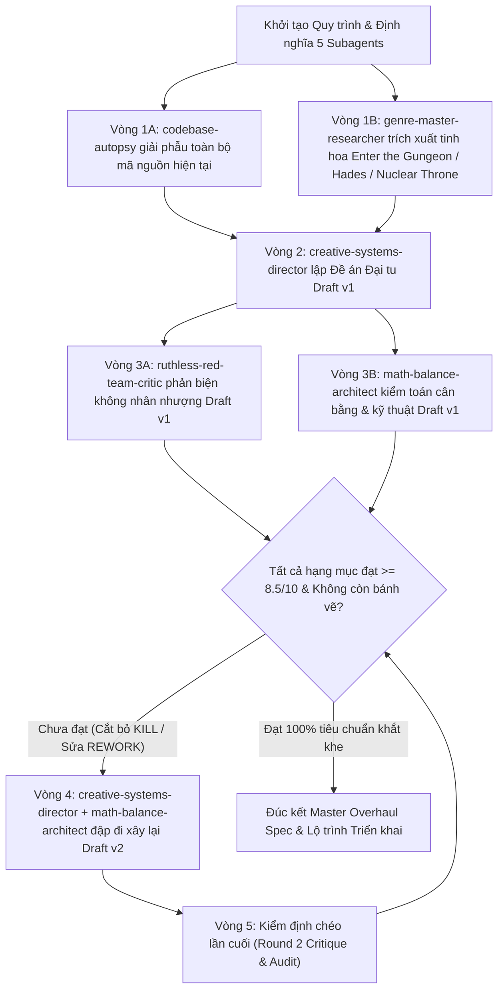

# QUY TRÌNH PHỐI HỢP & PHẢN BIỆN ĐA AGENT KHÔNG NHÂN NHƯỢNG (ADVERSARIAL MULTI-AGENT GAME DESIGN WORKFLOW)

> **Mục tiêu tối thượng:** Đổi mới toàn diện **Ashen Pact (Khế Ước Tro Tàn)** từ một bản demo mang nặng bóng dáng *Soul Knight* thành một tựa game Action Roguelite Co-op có bản sắc riêng, kịch tính, gây nghiện, cân bằng chặt chẽ và hoàn thiện 100% về mặt trải nghiệm (chắt lọc tinh hoa từ *Enter the Gungeon*, *Hades*, *Nuclear Throne*, *Wizard of Legend*).

---

## 1. NGUYÊN TẮC CỐT LÕI (ANTI-SYCOPHANCY & ZERO-VAPORWARE RULES)

1. **Cấm Bênh Nhau / Cấm Khen Xã Giao (Zero Sycophancy):**
   - Mọi Agent phản biện (`ruthless-red-team-critic`, `math-balance-architect`) **TUYỆT ĐỐI CẤM** dùng các câu mở đầu khen ngợi sáo rỗng ("Ý tưởng rất sáng tạo", "Thiết kế khá tốt nhưng...").
   - Đi thẳng vào điểm yếu, sự nhàm chán, sự phức tạp thừa thãi, hoặc lỗi mất cân bằng.
2. **Thẳng Tay Trảm Tính Năng Cũ & Tính Năng Rác (Ruthless Pruning):**
   - Không giữ lại bất kỳ tính năng nào của game hiện tại chỉ vì "đã lỡ code rồi". Nếu nó nhạt nhẽo, lặp lại, hoặc quá giống *Soul Knight* đời cũ mà không tạo ra quyết định chiến thuật thú vị -> **XÓA (`KILL`)** để dồn tài nguyên cho tính năng chất lượng cao.
   - Nguyên tắc **"Cắt 1 để Sâu 3"**: Thà có 15 vũ khí mà mỗi khẩu là một lối chơi/nhịp điệu hoàn toàn khác biệt, còn hơn 30 khẩu chỉ khác nhau con số `damage`, `fireRate`, `spreadDeg`.
3. **Chống "Bánh Vẽ" (Anti-Vaporware & 100% Completeness Gate):**
   - Mọi tính năng được đề xuất phải vượt qua **Bài Toán 3 Giây**: Người chơi nhìn vào màn hình có hiểu ngay lập tức chuyện gì đang xảy ra trong 3 giây mà không cần đọc bảng hướng dẫn dài dòng không?
   - Mọi cơ chế phải khả thi 100% trên kiến trúc `WorldSim` 60Hz tất định (`packages/shared/src/sim`) và Procedural Vector Art (`apps/client/src`) mà không cần phụ thuộc vào tài nguyên 3D hay animation phức tạp ngoài tầm kiểm soát.
4. **Cấm Buff Chỉ Số Thuần Túy Đội Lốt Phước Lành (No Disguised Stat-Sticks):**
   - Một thẻ Phước Lành / Khế Ước chỉ cộng `+15% sát thương`, `+20% tốc bắn`, `+2 Giáp` là **THẤT BẠI THIẾT KẾ**.
   - Mỗi thẻ phải thay đổi **hành vi chiến đấu (Combat Verb / Behavior)**, vị trí đứng, nhịp nạp đạn/lướt, hoặc cách tương tác với môi trường và đồng đội.

---

## 2. CƠ CẤU HỘI ĐỒNG 5 CHUYÊN GIA (AGENT ROLES & MANDATES)

| Mã Agent | Vai trò | Nhiệm vụ & Góc nhìn bắt buộc |
|---|---|---|
| `codebase-autopsy` | **Chuyên Gia Giải Phẫu Hiện Trạng** | Đọc sâu toàn bộ code thực tế (`packages/shared/src/sim`, `data/`, `apps/client`). Vạch trần mọi điểm khiến game hiện tại mang cảm giác "demo sơ sài", lặp lại, thiếu tương tác, giống *Soul Knight* một cách máy móc. |
| `genre-master-researcher` | **Chuyên Gia Giải Mã Tinh Hoa Roguelite** | Phân tích cơ chế cốt lõi của *Enter the Gungeon*, *Hades*, *Nuclear Throne*, *Wizard of Legend*: tại sao việc bắn súng, lật bàn, né đạn, ghép Synergy và chọn Boon/Curse của họ lại gây nghiện qua hàng trăm giờ chơi? |
| `creative-systems-director` | **Giám Đốc Sáng Tạo & Thiết Kế Hệ Thống** | Tổng hợp báo cáo để kiến tạo bản thiết kế **Ashen Pact 2.0**: Đập bỏ cái cũ, thiết kế lại Cấu trúc Màn chơi & Tương tác Map, Cơ chế Vũ khí Chủ động, Hệ thống Thẻ Phước Lành & Khế Ước Tro Tàn, và Hành trình Tiến hóa trong Run. |
| `ruthless-red-team-critic` | **Phản Biện Đỏ (Red Team Critic)** | Đóng vai người chơi khó tính nhất & giám khảo thiết kế khắc nghiệt nhất. Tấn công trực diện vào bản nháp của `creative-systems-director`: vạch mặt các ý tưởng bánh vẽ, rối rắm, khó đọc trên màn hình, hoặc nhanh chán sau 3 lượt chơi. |
| `math-balance-architect` | **Kiến Trúc Sư Toán Học & Cân Bằng** | Kiểm toán độc lập về mặt toán học: Công thức sát thương, giới hạn cộng dồn (Caps/Diminishing Returns), kinh tế Năng lượng/Nhiệt/Vàng, TTK quái & Boss, Co-op Scaling 1–4P, và ánh xạ trực tiếp vào cấu trúc dữ liệu `WorldSim`. |

---

## 3. GIAO THỨC BẢNG ĐEN (SHARED BLACKBOARD PROTOCOL)

Để các Subagent làm việc ăn khớp tuyệt đối và đọc được toàn bộ lập luận của nhau mà không bị tam sao thất bản, mọi kết quả trung gian đều được lưu vào thư mục `docs/superpowers/specs/council/`:

1. `docs/superpowers/specs/council/01-codebase-autopsy.md` — Báo cáo giải phẫu hiện trạng codebase Ashen Pact.
2. `docs/superpowers/specs/council/02-genre-master-analysis.md` — Báo cáo phân tích cơ chế từ *Enter the Gungeon* & các tựa game đỉnh cao.
3. `docs/superpowers/specs/council/03-draft-v1-overhaul.md` — Đề án Đại tu Ashen Pact 2.0 (Phiên bản v1).
4. `docs/superpowers/specs/council/04-round1-red-team-critique.md` — Biên bản Phản biện Đỏ Vòng 1 (Chấm điểm & Phán quyết `KEEP` / `REWORK` / `KILL`).
5. `docs/superpowers/specs/council/05-round1-math-tech-audit.md` — Biên bản Kiểm toán Toán học, Cân bằng & Kỹ thuật Vòng 1.
6. `docs/superpowers/specs/council/06-draft-v2-overhaul.md` — Đề án Đại tu Ashen Pact 2.0 (Phiên bản v2 sau khi cắt bỏ bánh vẽ & tinh chỉnh toán học).
7. `docs/superpowers/specs/council/07-round2-final-verdict.md` — Biên bản Phản biện Chốt hạ Vòng 2 (Đảm bảo 100% hạng mục đạt chuẩn).
8. `docs/superpowers/specs/2026-10-26-ashen-pact-2.0-overhaul-design.md` — **Bản Đặc Tả Thiết Kế Tổng Thể Cuối Cùng (Master Overhaul Design Document)**.

---

## 4. THANG ĐÁNH GIÁ BẮT BUỘC (SCORING RUBRIC — PHẢI ĐẠT >= 8.5/10 MỌI TIÊU CHÍ)

Trong mỗi vòng phản biện, `ruthless-red-team-critic` và `math-balance-architect` bắt buộc chấm điểm từng trụ cột theo 6 tiêu chí sau:

1. **Thoát bóng Soul Knight & Bản sắc riêng (Distinct Identity):** Map, nhịp độ chiến đấu và cơ chế cốt lõi có tạo ra cảm giác hoàn toàn khác biệt, sắc sảo như *Enter the Gungeon* / *Hades* không?
2. **Sự khác biệt giữa các Màn & Tương tác Môi trường (Biome & Tactical Room Play):** Mỗi màn có quy luật chơi riêng, vật thể tương tác chiến thuật (lật bàn/vật chắn, bẫy dây chuyền, địa hình động) khiến cách di chuyển thay đổi hẳn không?
3. **Độ sướng & Đa dạng Kiểu chơi Vũ khí (Weapon Archetype Depth):** Các vũ khí có cơ chế chủ động (Active Reload, Charge-Release, Combo, Heat/Overcharge, Tether, Ricochet) thay vì chỉ giữ chuột trái bắn đạn thẳng không?
4. **Độ đột biến của Phước lành & Khế ước (Blessing & Pact Transformative Power):** Các thẻ nâng cấp có thực sự biến đổi lối chơi và tạo ra các tổ hợp (Synergy) bùng nổ mà người chơi cảm nhận bằng mắt và tay ngay lập tức không?
5. **Độ sâu Hành trình Phát triển (Run Progression Arc):** Từ Phòng 1 Tầng 1 đến Boss Tầng cuối, người chơi có luôn có mục tiêu ngắn hạn & dài hạn gây kích thích (tiến hóa vũ khí, khế ước đánh đổi, rèn nâng cấp) không?
6. **Cân bằng Toán học & Chống Rối Rắm (Balance, Readability & 100% Completeness):** Có dễ hiểu trong 3 giây không? Có giữ được cân bằng chặt chẽ (không quá dễ, không bất công) và khả thi 100% trong codebase hiện tại không?

---

## 5. QUY TRÌNH LẶP ĐẾN KHI ĐẠT PHIÊN BẢN ƯNG Ý NHẤT (EXECUTION LOOP)

